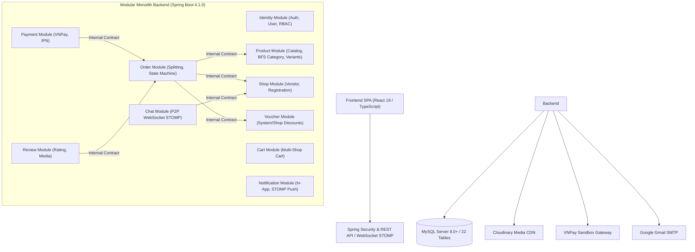

# 🛍️ Enterprise Multi-Vendor E-Commerce Platform
### Hệ Thống Thương Mại Điện Tử Đa Người Bán

[](https://openjdk.org/)
[](https://spring.io/projects/spring-boot)
[](https://react.dev/)
[](https://www.typescriptlang.org/)
[](https://vitejs.dev/)
[](https://tailwindcss.com/)
[](https://www.mysql.com/)
[](#10-kết-quả-kiểm-thử--audit-hệ-thống)

> **Enterprise Multi-Vendor E-Commerce Platform** là nền tảng thương mại điện tử đa người bán (Marketplace) được xây dựng theo kiến trúc **Modular Monolith** hoàn chỉnh trên nền tảng **Spring Boot 4 (Java 21)** và **React 19 (TypeScript)**.  
> Hệ thống giải quyết bài toán phức tạp của sàn TMĐT: cho phép khách hàng mua sắm từ nhiều gian hàng khác nhau trong cùng một giỏ hàng, tự động tách thành các đơn hàng độc lập cho từng gian hàng khi thanh toán, đồng thời tích hợp cổng thanh toán VNPay an toàn (idempotent), hệ thống nhắn tin trực tiếp thời gian thực qua WebSocket STOMP, và bảng điều khiển quản trị toàn diện.

---

## 📑 Mục Lục (Table of Contents)

1. [Điểm Nhấn Kỹ Thuật & Nghiệp Vụ Cốt Lõi](#1-điểm-nhấn-kỹ-thuật--nghiệp-vụ-cốt-lõi)
2. [Kiến Trúc Hệ Thống (Modular Monolith)](#2-kiến-trúc-hệ-thống-modular-monolith)
3. [Công Nghệ Sử Dụng (Technology Stack)](#3-công-nghệ-sử-dụng-technology-stack)
4. [Cấu Trúc Thư Mục Dự Án (Project Structure)](#4-cấu-trúc-thư-mục-dự-án-project-structure)
5. [Yêu Cầu Môi Trường & Cài Đặt (Prerequisites & Setup)](#5-yêu-cầu-môi-trường--cài-đặt-prerequisites--setup)
6. [Biến Môi Trường (.env)](#6-biến-môi-trường-env)
7. [Các Lệnh Khởi Chạy Hệ Thống (Startup Commands)](#7-các-lệnh-khởi-chạy-hệ-thống-startup-commands)
8. [Danh Sách Cổng Mạng & Endpoints](#8-danh-sách-cổng-mạng--endpoints)
9. [Tài Khoản Kiểm Thử & Phân Quyền (RBAC)](#9-tài-khoản-kiểm-thử--phân-quyền-rbac)
10. [Kết Quả Kiểm Thử & Audit Hệ Thống](#10-kết-quả-kiểm-thử--audit-hệ-thống)
11. [Thông Tin Cổng Thanh Toán VNPay Sandbox](#11-thông-tin-cổng-thanh-toán-vnpay-sandbox)
12. [Kịch Bản Trình Diễn Hệ Thống (Demo Script)](#12-kịch-bản-trình-diễn-hệ-thống-demo-script)
13. [Xử Lý Sự Cố Thường Gặp (Troubleshooting)](#13-xử-lý-sự-cố-thường-gặp-troubleshooting)

---

## 1. Điểm Nhấn Kỹ Thuật & Nghiệp Vụ Cốt Lõi

### 🛒 Tách Đơn Hàng Đa Gian Hàng (Multi-Vendor Cart Splitting & Aggregated Checkout)
- **Bài toán:** Khách hàng gom sản phẩm từ $N$ gian hàng khác nhau vào cùng một giỏ hàng và thanh toán một lần duy nhất.
- **Giải pháp:** Hệ thống gom các đơn hàng theo `payment_group_id` (UUID), đồng thời phân rã nguyên tử (*atomically split*) thành $N$ đơn hàng độc lập cho $N$ shop tương ứng trong một `@Transactional` duy nhất.
- **Tính toàn vẹn (All-or-Nothing):** Toàn bộ quá trình kiểm tra tồn kho và trừ kho diễn ra nhất quán. Nếu một sản phẩm thuộc bất kỳ gian hàng nào bị thiếu hàng, toàn bộ giao dịch sẽ rollback, đảm bảo không có đơn hàng dở dang.

### 💳 Thanh Toán VNPay & Cơ Chế Chống Trùng Lặp (Idempotent Webhook IPN)
- **Chống Replay Attack & Duplicate Credit:** Tích hợp kiểm tra mã băm bảo mật HMAC-SHA512. Sử dụng khóa bi quan (`PESSIMISTIC_WRITE`) trên bảng `payments` để bảo vệ quá trình tiếp nhận IPN từ VNPay, ngăn chặn tuyệt đối việc cập nhật đơn hàng hoặc cộng tiền lặp lại.
- **Retry Thanh Toán Linh Hoạt (1:N):** Khi giao dịch thanh toán thất bại, đơn hàng vẫn được bảo lưu ở trạng thái `PENDING`, cho phép khách hàng nhấn "Thanh toán lại" để khởi tạo một URL thanh toán mới cùng `payment_group_id` mà không bị hủy đơn nhầm.

### 🎟️ Phân Bổ Chiết Khấu Voucher Tỷ Lệ (Proportional Split)
- Hệ thống hỗ trợ 2 cấp độ mã giảm giá: **Voucher Sàn** (`SYSTEM`) và **Voucher Gian Hàng** (`SHOP`).
- Đối với Voucher toàn sàn, giá trị chiết khấu được tự động chia đều theo tỷ trọng tổng tiền của từng shop trong đơn hàng, đảm bảo công bằng cho đối soát doanh thu của từng Vendor.

### 💬 Nhắn Tin Real-time Hai Chiều (WebSocket STOMP + Shopee Floating Chat Widget)
- Kết nối WebSocket qua giao thức STOMP (`/ws`) với SockJS fallback.
- Xác thực bảo mật JWT ngay tại tầng STOMP (`JwtChannelInterceptor`).
- Định tuyến tin nhắn P2P chính xác qua Spring `SimpMessagingTemplate.convertAndSendToUser`.
- Khung chat nổi (Shopee-style Floating Chat Widget) hỗ trợ **Optimistic UI (0ms perceived latency)**, bộ đếm tin nhắn chưa đọc toàn cục và cơ chế tự động kết nối lại khi mất mạng.

### ⚡ Transaction Boundaries & Tách Rời Tác Vụ Bất Đồng Bộ
- Sử dụng `@TransactionalEventListener(phase = TransactionPhase.AFTER_COMMIT)` kết hợp `@Async` để xử lý các tác vụ phụ (gửi email thông báo kích hoạt Shop qua Gmail SMTP, phát thông báo Realtime STOMP).
- Đảm bảo side-effects chỉ được kích hoạt sau khi dữ liệu CSDL đã commit 100%, loại bỏ rủi ro gửi thông báo ảo khi giao dịch bị rollback.
- Rà soát triệt để bài toán **N+1 Query** bằng `@EntityGraph` và `JOIN FETCH`.

---

## 2. Kiến Trúc Hệ Thống (Modular Monolith)

Hệ thống được thiết kế theo mô hình **Modular Monolith**, bao gồm 10 modules nghiệp vụ hoàn toàn độc lập được đóng gói trong một ứng dụng Spring Boot duy nhất:



### Nguyên tắc ranh giới module nghiêm ngặt:
1. **Không truy cập chéo Entity / Repository:** Mỗi module chỉ quản lý tập Entity và Repository nội bộ của mình.
2. **Giao tiếp qua Internal Contracts:** Mọi tương tác liên module đều phải thông qua giao diện `*InternalService` và DTO nội bộ.
3. **Liên kết lỏng lẻo:** Các module như `Chat` và `Notification` chỉ lưu các ID nguyên thủy (`buyerId`, `shopId`, `senderId`) thay vì quan hệ `@ManyToOne`, giúp hệ thống dễ dàng bóc tách thành Microservices khi có nhu cầu mở rộng.

---

## 3. Công Nghệ Sử Dụng (Technology Stack)

| Lĩnh vực | Công nghệ | Phiên bản | Mô tả chi tiết |
|---|---|---|---|
| **Backend Core** | Java | 21 (LTS) | Ngôn ngữ hiện đại với Virtual Threads, Records, Pattern Matching |
| **Framework** | Spring Boot | 4.1.0 | Nền tảng micro-framework cho ứng dụng doanh nghiệp |
| **Bảo mật** | Spring Security & JJWT | 0.12.5 | Xác thực JWT Bearer Token, kiểm soát quyền theo vai trò (RBAC) |
| **ORM / Database** | Spring Data JPA / Hibernate | 6.x | Tối ưu hóa truy vấn, giải quyết N+1, khóa bi quan chống race condition |
| **Realtime Protocol** | Spring WebSocket & STOMP | - | Kênh tin nhắn thời gian thực hai chiều kèm SockJS fallback |
| **Tài liệu API** | SpringDoc OpenAPI (Swagger UI) | 3.0.3 | Tự động sinh tài liệu chuẩn OpenAPI v3 tại `/swagger-ui/index.html` |
| **Thư điện tử** | Spring Mail (JavaMail) | 4.0.1 | Gửi email kích hoạt gian hàng qua Gmail SMTP (TLS 587) |
| **Frontend Core** | React | 19.2.8 | Giao diện Single Page Application (SPA) hiệu năng cao |
| **Ngôn ngữ Frontend**| TypeScript | 6.0.2 | Kiểm soát kiểu tĩnh nghiêm ngặt (Strict Type Checking, 0 `any`) |
| **Build Tool** | Vite | 8.2.0 | Tối ưu đóng gói và Hot Module Replacement (HMR) cực nhanh |
| **Styling & UI** | Tailwind CSS & Lucide Icons | 4.3.3 / 1.31.0 | Hệ thống giao diện hiện đại, responsive, thẩm mỹ cao |
| **Realtime Client** | `@stomp/stompjs` & `sockjs-client` | 7.3.0 / 1.6.1 | Quản lý kết nối STOMP client, tự động kết nối lại |
| **Cơ sở dữ liệu** | MySQL Server | 8.0+ | Hệ quản trị CSDL quan hệ với 22 bảng chuẩn hóa |
| **Dịch vụ lưu trữ** | Cloudinary Media CDN | 1.36.0 | Lưu trữ và tối ưu hóa hình ảnh sản phẩm & đánh giá |
| **Cổng thanh toán** | VNPay Payment Gateway | v2.1.0 | Môi trường Sandbox thử nghiệm thanh toán thẻ ATM nội địa |

---

## 4. Cấu Trúc Thư Mục Dự Án (Project Structure)

```text
ecommerce/
├── docs/                               # Toàn bộ tài liệu phân tích, kiến trúc và báo cáo
│   ├── ARCHITECTURE.md                 # Quy tắc kiến trúc Modular Monolith
│   ├── PROJECT_CONTEXT.md              # Bối cảnh và tiến độ phát triển
│   ├── DATABASE_TABLE_SPECIFICATION.md # Đặc tả chi tiết 22 bảng CSDL
│   └── diagrams/                       # Sơ đồ Use Case, Class, Sequence, Architecture
├── frontend/                           # Ứng dụng Single Page Application (React 19 + TypeScript)
│   ├── src/
│   │   ├── api/                        # Axios HTTP clients & TypeScript Types
│   │   ├── components/                 # UI components (Layout, Products, Chat, Reviews, Shop)
│   │   ├── contexts/                   # Global state (Auth, Cart, Chat, Notification)
│   │   ├── pages/
│   │   │   ├── admin/                  # Phân hệ Quản trị (Dashboard, Shop, Order, Voucher, Payout)
│   │   │   ├── vendor/                 # Phân hệ Kênh Người Bán (Overview, Products, Orders, Payout)
│   │   │   └── public/                 # Phân hệ Khách hàng (Storefront, Cart, Checkout, Profile)
│   │   ├── services/                   # Dịch vụ WebSocket STOMP Client
│   │   ├── App.tsx                     # Cấu hình định tuyến Router & Providers
│   │   └── main.tsx                    # Entry point React
│   ├── package.json
│   └── vite.config.ts
├── src/main/java/com/tmt/ecommerce/    # Mã nguồn Backend Modular Monolith
│   ├── common/                         # Lớp dùng chung (ApiResponse, Exception Handling, Security)
│   ├── identity/                       # Module Định danh & Phân quyền (Auth, User)
│   ├── shop/                           # Module Gian hàng & Kiểm duyệt
│   ├── product/                        # Module Danh mục, Sản phẩm, Biến thể
│   ├── cart/                           # Module Giỏ hàng
│   ├── order/                          # Module Đơn hàng & Tách đơn
│   ├── payment/                        # Module Thanh toán VNPay
│   ├── voucher/                        # Module Khuyến mãi & Chiết khấu
│   ├── review/                         # Module Đánh giá sản phẩm
│   ├── notification/                   # Module Thông báo
│   ├── chat/                           # Module Nhắn tin Realtime STOMP
│   └── infrastructure/                 # Dịch vụ hạ tầng (Cloudinary CDN, Email)
├── src/test/java/                      # 312 Unit & Integration Tests (Pass 100%)
├── pom.xml                             # Cấu hình Maven dependencies
└── README.md                           # Tài liệu tổng quan dự án
```

---

## 5. Yêu Cầu Môi Trường & Cài Đặt (Prerequisites & Setup)

### Yêu cầu phần mềm tối thiểu:
- **Java Development Kit (JDK):** OpenJDK 21 hoặc Oracle JDK 21+ (`java -version`)
- **Node.js & npm:** Node.js v18.x hoặc v20.x+ LTS và npm v9.x+ (`node -v`, `npm -v`)
- **MySQL Server:** Phiên bản 8.0 trở lên (`mysql --version`)
- **Git:** Quản lý mã nguồn (`git --version`)

*(Dự án đã tích hợp sẵn Maven Wrapper `./mvnw` và `mvnw.cmd`, không bắt buộc cài đặt Maven rời).*

### 1. Khởi tạo Cơ sở dữ liệu MySQL:
Mở MySQL Client và thực thi lệnh tạo cơ sở dữ liệu với bảng mã `utf8mb4`:

```sql
CREATE DATABASE IF NOT EXISTS ecommerce 
CHARACTER SET utf8mb4 
COLLATE utf8mb4_unicode_ci;
```

---

## 6. Biến Môi Trường (.env)

Hệ thống nạp các biến cấu hình từ tệp `.env` tại thư mục gốc của dự án hoặc thông qua biến môi trường của hệ điều hành.  
Sao chép tệp mẫu [.env.example](file:///c:/Users/Dell/IdeaProjects/ecommerce/.env.example) thành `.env`:

```properties
# --- Kết Nối Cơ Sở Dữ Liệu MySQL ---
DB_PASSWORD=your_mysql_password_here

# --- Khóa Bí Mật JWT (HMAC-SHA256 tối thiểu 256-bit) ---
JWT_SECRET_KEY=your_base64_or_hex_encoded_secret_key_minimum_256_bits_here

# --- Google Gmail SMTP (Gửi email tự động) ---
MAIL_USERNAME=your_email@gmail.com
MAIL_PASSWORD=your_16_digit_google_app_password

# --- Cloudinary CDN (Lưu trữ ảnh sản phẩm & đánh giá) ---
CLOUDINARY_CLOUD_NAME=your_cloudinary_cloud_name
CLOUDINARY_API_KEY=your_cloudinary_api_key
CLOUDINARY_API_SECRET=your_cloudinary_api_secret

# --- Cổng Thanh Toán VNPay Sandbox ---
VNPAY_TMN_CODE=your_vnpay_tmn_code
VNPAY_SECRET_KEY=your_vnpay_secret_key
VNPAY_API_IP=127.0.0.1
```

---

## 7. Các Lệnh Khởi Chạy Hệ Thống (Startup Commands)

### Bước 1: Khởi động Backend (Spring Boot)

Mở Terminal tại thư mục gốc dự án (`ecommerce/`):

**Trên Windows (PowerShell):**
```powershell
# Gán biến môi trường (hoặc để Spring Boot tự nạp từ tệp .env)
$env:DB_PASSWORD="your_mysql_password"

# Khởi chạy ứng dụng
.\mvnw.cmd spring-boot:run
```

**Trên Linux / macOS (Bash):**
```bash
chmod +x ./mvnw
export DB_PASSWORD="your_mysql_password"
./mvnw spring-boot:run
```

*Khi thấy thông báo: `Started EcommerceApplication in ... seconds`, Backend đã sẵn sàng tại `http://localhost:8080`.*

---

### Bước 2: Khởi động Frontend (React / Vite)

Mở một cửa sổ Terminal thứ hai, di chuyển vào thư mục `frontend`:

```bash
cd frontend

# Cài đặt thư viện phụ thuộc (lần đầu tiên)
npm install

# Khởi chạy máy chủ phát triển Vite
npm run dev
```

*Frontend sẽ chạy tại `http://localhost:5173`. Mở trình duyệt và truy cập để trải nghiệm hệ thống.*

---

## 8. Danh Sách Cổng Mạng & Endpoints

| Thành phần | Cổng mạng (Port) | Đường dẫn truy cập | Chức năng |
|---|---|---|---|
| **Frontend Web App** | `5173` | `http://localhost:5173` | Giao diện Khách hàng, Vendor Portal, Admin Dashboard |
| **Backend REST API** | `8080` | `http://localhost:8080` | Cổng máy chủ Spring Boot API |
| **Swagger UI (API Docs)** | `8080` | `http://localhost:8080/swagger-ui/index.html` | Xem và thử nghiệm trực quan toàn bộ API Endpoints |
| **OpenAPI Spec (JSON)** | `8080` | `http://localhost:8080/v3/api-docs` | Cấu hình đặc tả chuẩn JSON OpenAPI v3 |
| **WebSocket STOMP** | `8080` | `ws://localhost:8080/ws` | Kênh kết nối Chat và Thông báo thời gian thực |
| **MySQL Database** | `3306` | `localhost:3306` | Kết nối CSDL `ecommerce` |

---

## 9. Tài Khoản Kiểm Thử & Phân Quyền (RBAC)

Hệ thống được thiết kế với 3 nhóm vai trò phân tách chặt chẽ:

| Tác nhân | Email đăng nhập | Mật khẩu mẫu | Vai trò (Role) | Không gian phân quyền |
|---|---|---|---|---|
| **Quản trị viên (Admin)** | `admin@test.com` | `Password123!` | `ROLE_ADMIN` | `/admin/*` — Xem KPI sàn, duyệt/khóa Shop, quản lý đơn, voucher sàn |
| **Chủ gian hàng (Vendor)** | `vendor@test.com` | `Password123!` | `ROLE_VENDOR` | `/vendor/*` — Quản lý sản phẩm, đơn hàng shop, voucher shop, rút tiền |
| **Khách hàng (Customer)** | `buyer@test.com` | `Password123!` | `ROLE_CUSTOMER` | Storefront, Giỏ hàng đa shop, Checkout VNPay, Lịch sử đơn, Chat P2P |

---

## 10. Kết Quả Kiểm Thử & Audit Hệ Thống

Toàn bộ hệ thống đã vượt qua kiểm tra chất lượng toàn diện:

### 1. Backend Test Suite (312 / 312 Tests Passed)
```text
[INFO] -------------------------------------------------------
[INFO]  T E S T S
[INFO] -------------------------------------------------------
[INFO] Running com.tmt.ecommerce.order.TransactionAuditIntegrationTest
[INFO] Tests run: 26, Failures: 0, Errors: 0, Skipped: 0
...
[INFO] Running com.tmt.ecommerce.voucher.VoucherUsageIntegrationTest
[INFO] Tests run: 2, Failures: 0, Errors: 0, Skipped: 0
[INFO] 
[INFO] Results:
[INFO] 
[INFO] Tests run: 312, Failures: 0, Errors: 0, Skipped: 0
[INFO] ------------------------------------------------------------------------
[INFO] BUILD SUCCESS
[INFO] ------------------------------------------------------------------------
```
- **Kiểm thử giao dịch:** Đảm bảo tính toàn vẹn *All-or-Nothing* khi tách đơn hàng đa shop.
- **Kiểm thử Idempotency:** Đảm bảo webhook VNPay IPN không lặp lại cập nhật đơn hàng.

### 2. Frontend Build Verification
```text
$ npx tsc --noEmit
=> Exit code: 0 (0 Type Errors)

$ npm run build
✓ 1935 modules transformed.
dist/index.html                   0.45 kB │ gzip:   0.29 kB
dist/assets/index-B3CfVL64.css   78.76 kB │ gzip:  13.44 kB
dist/assets/index-C202aLbu.js   671.71 kB │ gzip: 172.47 kB
✓ built in 3.02s
=> Exit code: 0 (Production bundle ready)
```

---

## 11. Thông Tin Cổng Thanh Toán VNPay Sandbox

Dự án tích hợp chính thức cổng thử nghiệm của VNPay:

- **Cổng thanh toán URL:** `https://sandbox.vnpayment.vn/paymentv2/vpcpay.html`
- **Phiên bản API:** `2.1.0` | **Thuật toán băm:** `HmacSHA512`
- **Thông tin thẻ ATM kiểm thử chính thức:**

| Thuộc tính | Giá trị kiểm thử | Ghi chú |
|---|---|---|
| **Ngân hàng chấp nhận** | **NCB** (Ngân hàng Quốc Dân) | Chọn logo ngân hàng NCB trên màn hình thanh toán |
| **Số thẻ ATM** | `9704198526191432198` | Thẻ test sandbox của VNPay |
| **Tên chủ thẻ** | `NGUYEN VAN A` | Viết hoa không dấu |
| **Ngày phát hành** | `07/15` | Tháng/Năm |
| **Mã xác thực OTP** | `123456` | Mã OTP cố định trong môi trường Sandbox |

---

## 12. Kịch Bản Trình Diễn Hệ Thống (Demo Script)

Khuyến nghị mở 3 cửa sổ trình duyệt ẩn danh độc lập đại diện cho 3 tác nhân:

1. **Bước 1 — Khách hàng mua sắm & Thanh toán VNPay (Tab Customer):**
   - Đăng nhập tài khoản `buyer@test.com`.
   - Chọn sản phẩm từ các shop khác nhau vào giỏ hàng `/cart`.
   - Tiến hành checkout, áp dụng mã voucher sàn, chọn phương thức VNPay Sandbox.
   - Nhập thông tin thẻ test NCB $\rightarrow$ Thanh toán thành công $\rightarrow$ Chuyển hướng về `/payment-result`.
2. **Bước 2 — Chat trao đổi thời gian thực (Tab Customer & Tab Vendor):**
   - Khách mở **Floating Chat Widget** góc phải, gửi tin nhắn hỏi shop về đơn hàng.
   - Bên tab Vendor (`vendor@test.com`), tin nhắn hiển thị tức thì qua WebSocket STOMP. Vendor phản hồi trực tiếp.
3. **Bước 3 — Quản lý & Xử lý đơn hàng (Tab Vendor):**
   - Vendor vào `/vendor/orders`, thấy đơn hàng đã thanh toán ở trạng thái `CONFIRMED`.
   - Nhấn "Xác nhận gửi hàng" $\rightarrow$ Đơn hàng chuyển sang `SHIPPED`.
4. **Bước 4 — Xác nhận nhận hàng & Đánh giá (Tab Customer):**
   - Khách hàng vào `/orders`, nhấn "Đã nhận được hàng" $\rightarrow$ Đơn hàng chuyển sang `DELIVERED`.
   - Khách viết đánh giá 5 sao và tải ảnh lên Cloudinary.
5. **Bước 5 — Điều hành Quản trị (Tab Admin):**
   - Admin đăng nhập `admin@test.com`, truy cập `/admin` để xem Dashboard biểu đồ doanh thu toàn sàn.
   - Kiểm duyệt các gian hàng mới hoặc tạo voucher khuyến mãi toàn sàn.

---

## 13. Xử Lý Sự Cố Thường Gặp (Troubleshooting)

| Vấn đề gặp phải | Nguyên nhân khả dĩ | Cách khắc phục |
|---|---|---|
| **Cổng 8080 bị chiếm dụng** | Tiến trình Java/Backend cũ chưa tắt | Chạy PowerShell: `Get-Process -Id (Get-NetTCPConnection -LocalPort 8080).OwningProcess \| Stop-Process -Force` |
| **Lỗi MySQL Connection Refused** | Dịch vụ MySQL chưa được khởi động | Mở `services.msc` hoặc chạy lệnh `net start mysql` trên Windows |
| **Lỗi sai mật khẩu MySQL** | Biến `DB_PASSWORD` không khớp | Kiểm tra lại mật khẩu `root` trong file `.env` hoặc tham số khởi chạy |
| **Lỗi gửi email kích hoạt Shop** | Gmail chưa bật App Password | Vào Bảo mật tài khoản Google $\rightarrow$ Tạo "Mật khẩu ứng dụng" 16 ký tự gán vào `MAIL_PASSWORD` |
| **Lỗi VNPay Invalid Checksum** | Sai mã `VNPAY_TMN_CODE` hoặc `VNPAY_SECRET_KEY` | Kiểm tra lại thông số trong file `.env`, đảm bảo không có khoảng trắng thừa |

---

## 📜 Giấy Phép (License)

Dự án được phát triển phục vụ mục đích nghiên cứu học thuật, đồ án tốt nghiệp chuyên ngành Kỹ thuật Phần mềm / Công nghệ Thông tin. Mọi quyền được bảo lưu.
