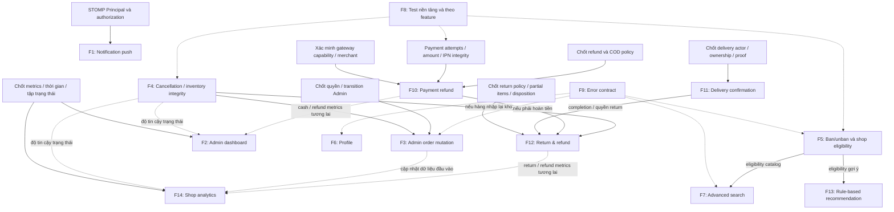
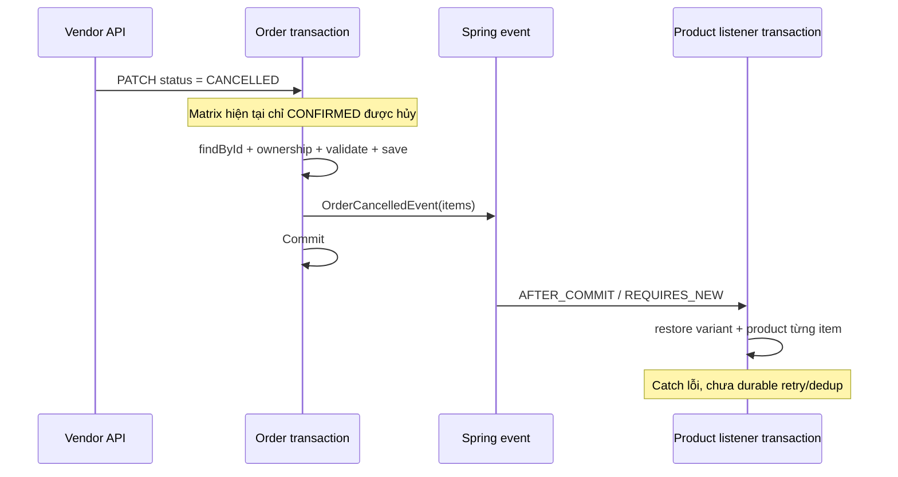

# PHASE 2 — Feature & Data Dependency Graph

Đối chiếu source: **2026-09-09**. Đồ thị giữ bối cảnh thiết kế ban đầu. Sprint 1 (F4/F5 và phần core F8/F9) đã triển khai và kiểm chứng theo [S1-07/08 final audit](PHASE2_S1_07_08_VERIFICATION.md); các feature Phase 2 còn lại không được coi là đã hoàn tất. Bằng chứng chi tiết tại [Feature Audit](PHASE2_FEATURE_AUDIT.md).

## 1. Cách đọc

Mũi tên liền: đầu vào/điều kiện cần của nhánh nghiệp vụ. Mũi tên nét đứt: điều kiện chất lượng, tác động hoặc phụ thuộc chỉ khi chọn nhánh đó. Số feature giữ nguyên backlog của người dùng.

P0–P4 là thứ tự ưu tiên đề xuất, không có nghĩa mọi feature tầng sau phải chờ toàn bộ tầng trước. F8 test và F9 error contract theo từng slice; F2/F14 số liệu đơn không cần đợi refund tồn tại. Quyết định nghiệp vụ chưa chốt là dependency riêng, không được thay bằng giả định.

## 2. Đồ thị tính năng



F4 không phải điều kiện của mọi refund: có hoàn tiền không kèm nhập kho. F14 không phải prerequisite của return; analytics nhận dữ liệu từ nghiệp vụ sau khi có ledger.

## 3. Ma trận dữ liệu và ownership

| Feature | Dữ liệu/module sở hữu | Contract hiện có / cần bổ sung |
|---|---|---|
| F1 | Notification: notifications; Chat: websocket infrastructure | Notification listener/service; cần hook sau commit và subscription dùng Principal thống nhất |
| F2 | Identity/User; Shop; Product; Order; Payment | Cần aggregate DTO/API nội bộ ở từng module, composition service không đọc repo xuyên module |
| F3 | Order/OrderItem; Payment nếu guard tài chính | OrderService/OrderInternalService; cần command Admin sau chốt transition |
| F4 | Order sở hữu status/items; Product sở hữu variant/product stock | OrderCancelledEvent có items; ProductInternalService có restoreStock |
| F5 | Shop status, Identity roles; Product/Order eligibility | ShopInternalService hiện lookup/ownership; cần eligibility contract và policy |
| F6 | Identity/User | Cần current-user profile service/DTO |
| F7 | Product/Category/Brand/Variant | Category và Brand đã có; query trong module Product, eligibility qua Shop contract |
| F8 | Logic module và test fixture | JUnit/Mockito sẵn có; cần DB test riêng cho lock/transaction |
| F9 | Common exception/response; security filter; FE types | Enum/AppException đã có; chuyển từng service và FE phụ thuộc message |
| F10 | Payment/attempt/group; Order amount | PaymentStrategy chưa refund; gateway contract là điều kiện còn thiếu |
| F11 | Order status; Identity nếu thêm actor | Chưa assignment/proof/delivery time contract |
| F12 | Order, Product, Payment, Media | Chưa Return contract/model; xác định ownership khi thiết kế |
| F13 | Product category, Order history, Cart, Review tùy rule | Cần DTO batch cho tín hiệu; chưa search/view history/wishlist |
| F14 | Order totals/items/status/date; Product category; Payment nếu cash | ShopInternalService xác định shop từ user; cần aggregate contract theo scope |

Theo [Architecture](ARCHITECTURE.md), không JOIN bảng module khác bằng repository hoặc tham chiếu entity/repository xuyên module. Khi cần lọc/sort toàn cục theo dữ liệu nhiều module, chọn contract batch hoặc projection cục bộ; không lọc Page sau truy vấn rồi giữ total cũ.

## 4. Chuỗi cancellation hiện có và lỗ hổng



Checkout đã trừ cả variant/product trước khi lưu đơn trong transaction checkout. Do đó:
- Hoàn kho phải tác động cả hai cấp.
- Cộng kho atomic chỉ bảo vệ phép cộng, không bảo vệ xử lý event đúng một lần.
- Guard status không khóa chưa chứng minh chống hai request hủy đồng thời.
- Khoảng cách giữa hai transaction cần được giải quyết bằng lựa chọn thiết kế.

Hai phương án kỹ thuật cần chốt: (A) hoàn kho đồng bộ qua internal contract trong transaction hủy, hoặc (B) giữ after-commit với outbox/dedup/retry bền vững. A ít hạ tầng hơn trong monolith; B cần schema và vận hành bổ sung. Không được giữ cả hai cơ chế cộng kho cùng lúc. Không mở thêm transition PENDING trong quá trình sửa lỗi.

## 5. Chuỗi payment/refund

```text
Order(s) đã tách shop
  → paymentGroupId + tổng amount
  → một hoặc nhiều Payment attempts
  → IPN signature + amount + lock theo transactionId
  → SUCCESS / FAILED
  → trạng thái Order tương ứng
  → [sau xác minh capability] refund command
  → số tiền còn được hoàn / partial order / idempotency
  → gateway hoặc quy trình COD đã chốt
  → đối soát kết quả / ledger
```

Các dependency chưa giải quyết:
- IPN trễ và bulk update Order không được hồi sinh CANCELLED.
- Idempotency một attempt không chống nhiều attempts thành công cùng group.
- Callback thiếu amount và trường gateway status cần đối chiếu gateway contract.
- Timeout refund có thể là kết quả chưa biết, không mặc định thất bại rồi gửi lại.
- COD trước và sau thực thu khác nhau; source chưa có collection ledger để coi mọi COD refund bằng 0.

## 6. Chuỗi analytics và recommendation

Analytics:
```text
Metric definition (status set, cohort date, timezone, gross/net meaning)
  → aggregate ở module sở hữu
  → batch/composition theo scope Admin hoặc shop của user
  → DTO có tên metric và khoảng thời gian rõ
  → chart/table + empty/error
```

Order count, order value và AOV có thể làm trước refund. Cash settlement, refund rate, net profit chưa đủ dữ liệu. createdAt của Order dùng được cho cohort đơn; không phải ngày delivered hoặc tiền thu. User/Shop/Product chưa có createdAt trong entity.

Recommendation:
```text
Product/Category + eligibility
  → same-category baseline
  → [tùy rule] Order history / Cart / Review signals qua contract
  → dedup + loại item không hiển thị + fallback
  → recommendation API/UI
```

Brand đã có trong schema mapping. Search/view history và wishlist chưa có, không là dependency bắt buộc của baseline. Co-purchase đa shop phải xác định dùng orderId hay paymentGroupId; API không nhận tùy ý userId của người khác.

## 7. Thứ tự implementation đề xuất

1. **F8 baseline + F9 error contract**, sau đó viết test cùng từng thay đổi.
2. **F4 inventory/state integrity**, bao gồm race với cập nhật payment group.
3. **F5 ban/unban** sau chốt hiệu lực và transitions, đồng bộ BE/FE.
4. **F3** sau quyết định Admin transitions; **F6**, **F1**, **F7** là các slice độc lập có thể đổi thứ tự theo nhu cầu.
5. **F2** sau chốt metric; có thể làm counts trước khi F3 hoàn thành.
6. **F14/F13** theo dữ liệu có sẵn và giới hạn đã công bố.
7. **F11** sau chốt actor; **F10** sau gateway capability/policy (khảo sát capability có thể làm sớm).
8. **F12** sau policy và các nhánh delivery/inventory/payment cần dùng đã sẵn sàng.

Xem [Implementation Plan](PHASE2_IMPLEMENTATION_PLAN.md) để biết thay đổi, kiểm thử và rollback từng feature.
