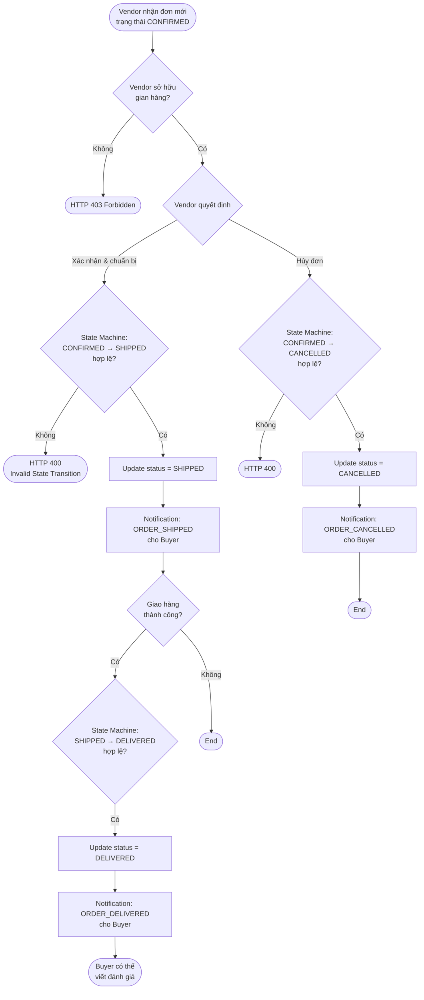

# ACTIVITY DIAGRAM SPECIFICATION

> Mô tả các luồng hoạt động nghiệp vụ quan trọng nhất của hệ thống.
> Tất cả đều phản ánh implementation thực tế.

---

## AD01 — Luồng Checkout đa gian hàng

**Business Flow:** Buyer đặt hàng nhiều sản phẩm từ nhiều gian hàng trong một lần thanh toán.

```mermaid
flowchart TD
    Start([Buyer nhấn "Đặt hàng"])
    --> InputValidation{Validate request\n@Valid}

    InputValidation -- Lỗi --> ReturnBad1([HTTP 400 Validation Error])
    InputValidation -- OK --> BeginTx[BEGIN @Transactional]

    BeginTx --> LoadVariants[Lấy thông tin\ntừng ProductVariant\nqua ProductInternalService]

    LoadVariants --> CheckStock{Tất cả sản phẩm\ncòn hàng?}
    CheckStock -- Không --> RollbackStock[ROLLBACK]
    RollbackStock --> ReturnBad2([HTTP 400 Insufficient Stock])

    CheckStock -- Có --> ApplyVoucher[Tính giảm giá\nVoucherInternalService.calculateDiscount]

    ApplyVoucher --> ValidateVoucher{Voucher hợp lệ?}
    ValidateVoucher -- Không --> RollbackVoucher[ROLLBACK]
    RollbackVoucher --> ReturnBad3([HTTP 400 Invalid Voucher])

    ValidateVoucher -- Có --> GroupByShop[Nhóm CartItem\ntheo shopId]

    GroupByShop --> CreateOrders[Tạo N Order entity\ncùng paymentGroupId]

    CreateOrders --> DeductStock[Trừ tồn kho\nbulk UPDATE product_variants]

    DeductStock --> IncrVoucher[Tăng used_count\nvoucher atomic SQL]

    IncrVoucher --> ClearCart[Xóa CartItem\nđã checkout]

    ClearCart --> Commit[COMMIT]

    Commit --> ReturnSuccess([HTTP 201\n{paymentGroupId, orderIds}])
```

---

## AD02 — Luồng Thanh toán VNPay (End-to-End)

**Business Flow:** Từ khi Buyer nhấn thanh toán đến khi đơn hàng được CONFIRMED.

```mermaid
flowchart TD
    Start([Buyer nhấn "Thanh toán VNPay"])

    Start --> ValidateOwnership[Validate paymentGroupId\nvà userId]
    ValidateOwnership --> GetAmount[Lấy tổng tiền\nOrderInternalService]
    GetAmount --> CreateRecord[Tạo Payment record\nstatus=PENDING]
    CreateRecord --> BuildURL[Tạo VNPAY URL\nHMAC-SHA512 sign]
    BuildURL --> Redirect([Redirect browser\nđến VNPay])

    Redirect --> UserPays{Người dùng\nthanh toán?}
    UserPays -- Hủy --> Failed1([Payment CANCELED])
    UserPays -- Thất bại --> Failed2([Payment FAILED])

    UserPays -- Thành công --> VNPayIPN[VNPay gửi\nGET /vnpay/ipn]

    VNPayIPN --> VerifyHMAC{Xác thực\nHMAC-SHA512}
    VerifyHMAC -- Sai --> Reject([RspCode 97\nInvalid Signature])

    VerifyHMAC -- OK --> LockPayment[SELECT FOR UPDATE\nPessimistic Lock]
    LockPayment --> CheckIdem{payment.status\n== PENDING?}
    CheckIdem -- Không --> IdempotentReturn([RspCode 00\nidempotent])

    CheckIdem -- Có --> CheckCode{ResponseCode\n== 00?}

    CheckCode -- Không --> MarkFailed[Payment.status = FAILED\nOrder giữ PENDING]
    MarkFailed --> CommitFailed[COMMIT]
    CommitFailed --> ReturnFailed([Buyer có thể\nthử thanh toán lại])

    CheckCode -- Có --> MarkSuccess[Payment.status = SUCCESS\nOrders → CONFIRMED]
    MarkSuccess --> CommitSuccess[COMMIT]
    CommitSuccess --> PublishEvent[publish OrderConfirmedEvent]
    PublishEvent --> Notify[AFTER_COMMIT:\nTạo Notifications\ncho Buyer và Vendor]
    Notify --> ReturnOK([RspCode 00\nConfirm Success])

    CommitFailed --> FrontendPoll[Frontend poll\n/payments/group/status]
    CommitSuccess --> FrontendPoll
```

---

## AD03 — Luồng Vendor quản lý đơn hàng (Order State Machine)

**Business Flow:** Vendor nhận và xử lý đơn từ CONFIRMED → DELIVERED hoặc CANCELLED.



---

## AD04 — Luồng Đăng ký và Duyệt gian hàng

**Business Flow:** Từ khi Buyer đăng ký mở shop đến khi được kích hoạt.

```mermaid
flowchart TD
    Start([Buyer đăng ký mở gian hàng\nPOST /api/v1/shops])

    Start --> CheckExist{User đã có\ngian hàng?}
    CheckExist -- Có --> Reject([HTTP 400 Already has shop])

    CheckExist -- Không --> CreateShop[Tạo Shop entity\nstatus = PENDING]
    CreateShop --> SaveShop[Lưu vào DB]
    SaveShop --> Return201([HTTP 201\nĐang chờ duyệt])

    Return201 --> AdminReview{Admin xem xét\n/admin/shops}

    AdminReview -- Từ chối --> BannedFlow[Manual: Shop.status = BANNED]
    BannedFlow --> NotifyReject([Thông báo thủ công])

    AdminReview -- Phê duyệt --> ApproveShop[PUT /admin/shops/{id}/approve]
    ApproveShop --> ValidatePending{Shop đang\nPENDING?}
    ValidatePending -- Không --> Error([HTTP 400])
    ValidatePending -- Có --> UpdateActive[Shop.status = ACTIVE]
    UpdateActive --> CommitDB[COMMIT]
    CommitDB --> PublishEvent[publish ShopApprovedEvent]
    PublishEvent --> SendEmail[AFTER_COMMIT ASYNC:\nGửi email qua Gmail SMTP]
    SendEmail --> VendorActivated([Vendor có thể\nthêm sản phẩm])
```

---

## AD05 — Luồng Viết đánh giá sản phẩm

**Business Flow:** Buyer viết đánh giá sau khi nhận hàng (có kiểm soát chặt).

```mermaid
flowchart TD
    Start([Buyer nhấn "Viết đánh giá"\nPOST /api/v1/reviews])

    Start --> CheckAuth{Đã đăng nhập\n(ROLE_USER)?}
    CheckAuth -- Không --> Deny([HTTP 401])

    CheckAuth -- Có --> GetDelivered[Lấy danh sách đơn hàng\ntrạng thái DELIVERED\nchứa sản phẩm này]
    GetDelivered --> CheckDelivered{request.orderId\ncó trong danh sách?}
    CheckDelivered -- Không --> Error1([HTTP 403\nChưa mua hoặc chưa nhận hàng])

    CheckDelivered -- Có --> CheckUnique{Unique constraint\n(userId, orderId, productId)\nchưa có?}
    CheckUnique -- Đã đánh giá --> Error2([HTTP 409\nĐã đánh giá đơn này])

    CheckUnique -- OK --> SaveReview[Lưu Review entity\n{userId, productId, orderId, rating, comment}]
    SaveReview --> Commit[COMMIT]
    Commit --> PublishEvent[publish ReviewCreatedEvent]
    PublishEvent --> Notify[AFTER_COMMIT:\nTạo Notification NEW_REVIEW\ncho Vendor]
    Notify --> Return201([HTTP 201 ReviewResponse])
```

---

## Tóm tắt Activity Diagrams

| AD | Tên | Decision Points | Key Mechanism |
|---|---|---|---|
| AD01 | Checkout đa gian hàng | Tồn kho, Voucher validation | @Transactional, atomic SQL |
| AD02 | Thanh toán VNPay | HMAC validation, idempotency, ResponseCode | Pessimistic Lock, AFTER_COMMIT event |
| AD03 | Vendor quản lý đơn | State Machine transition | Event-driven notification |
| AD04 | Đăng ký & duyệt shop | Shop existence, PENDING check | Async email AFTER_COMMIT |
| AD05 | Viết đánh giá | DELIVERED check, Unique constraint | Cross-module call via internal service |
