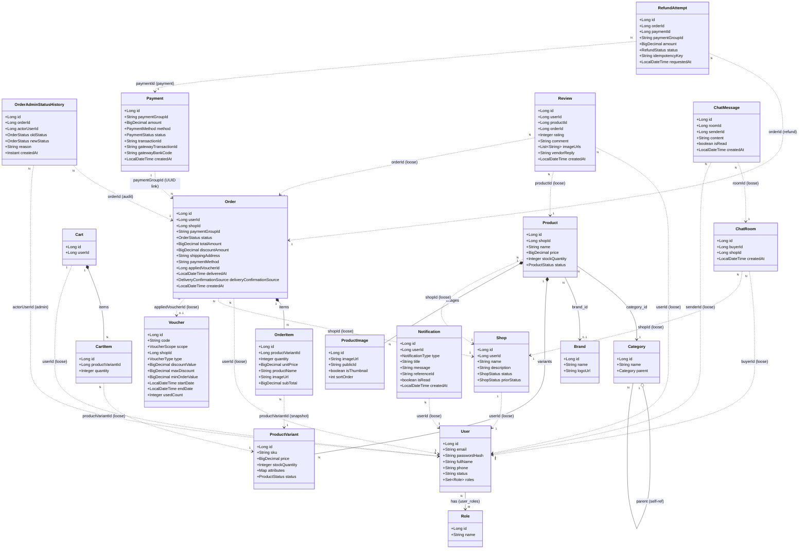

# CLASS DIAGRAM SPECIFICATION

> Tài liệu này mô tả đầy đủ các class, thuộc tính, và quan hệ để vẽ sơ đồ lớp.
> Mọi thông tin đều lấy trực tiếp từ Entity source code và đồng bộ chuẩn xác với cơ sở dữ liệu.

---

## 1. Danh sách Class

Hệ thống bao gồm **20 JPA Entities** phân chia theo các module nghiệp vụ trong kiến trúc Modular Monolith:

| STT | Class | Module | Table | Ghi chú |
|---|---|---|---|---|
| 1 | User | identity | `users` | Tài khoản & định danh |
| 2 | Role | identity | `roles` | Phân quyền (USER, VENDOR, ADMIN) |
| 3 | Shop | shop | `shops` | Gian hàng người bán |
| 4 | Brand | product | `brands` | Thương hiệu sản phẩm |
| 5 | Category | product | `categories` | Danh mục đa cấp (Self-reference) |
| 6 | Product | product | `products` | Thông tin sản phẩm chung |
| 7 | ProductVariant | product | `product_variants` | Biến thể (SKU, giá, kho, thuộc tính JSON) |
| 8 | ProductImage | product | `product_images` | Ảnh sản phẩm & Cloudinary publicId |
| 9 | Cart | cart | `carts` | Giỏ hàng người dùng |
| 10 | CartItem | cart | `cart_items` | Chi tiết mặt hàng trong giỏ |
| 11 | Order | order | `orders` | Đơn hàng theo shop |
| 12 | OrderItem | order | `order_items` | Chi tiết mặt hàng (Snapshot pattern) |
| 13 | OrderAdminStatusHistory | order | `order_admin_status_history` | Nhật ký Admin can thiệp đơn hàng (Audit Trail) |
| 14 | Payment | payment | `payments` | Giao dịch thanh toán theo nhóm đơn |
| 15 | RefundAttempt | payment | `refund_attempts` | Giao dịch hoàn tiền (Idempotency) |
| 16 | Voucher | voucher | `vouchers` | Mã giảm giá hệ thống / gian hàng |
| 17 | Review | review | `reviews` | Đánh giá & phản hồi đánh giá |
| 18 | Notification | notification | `notifications` | Thông báo trong ứng dụng |
| 19 | ChatRoom | chat | `chat_rooms` | Phòng chat giữa người mua & shop |
| 20 | ChatMessage | chat | `chat_messages` | Tin nhắn thời gian thực |

---

## 2. Đặc tả từng Class

### 2.1. User

```
class User {
  - id : Long [PK]
  - email : String [UNIQUE, NOT NULL, max 150]
  - passwordHash : String [NOT NULL]
  - fullName : String [NOT NULL, max 100]
  - phone : String [max 20]
  - status : String [NOT NULL, max 20]
  - roles : Set<Role> [ManyToMany → user_roles, Fetch EAGER]
}
```

### 2.2. Role

```
class Role {
  - id : Long [PK]
  - name : String [UNIQUE, NOT NULL, max 50]
    // ROLE_USER | ROLE_VENDOR | ROLE_ADMIN
}
```

### 2.3. Shop

```
class Shop {
  - id : Long [PK]
  - userId : Long [FK → User.id, UNIQUE, NOT NULL]
  - name : String [UNIQUE, NOT NULL, max 100]
  - description : String (TEXT)
  - status : ShopStatus [NOT NULL, max 20]
    // PENDING | ACTIVE | BANNED
  - priorStatus : ShopStatus [nullable, max 20]
    // Lưu trạng thái trước khi bị Ban để phục hồi khi Unban
}
```

**Lưu ý Loose Coupling:** `userId` là FK kiểu Long (không dùng `@ManyToOne User`). Đây là nguyên tắc Modular Monolith — tránh phụ thuộc 2 chiều trực tiếp giữa module `shop` và `identity`.

### 2.4. Brand

```
class Brand {
  - id : Long [PK]
  - name : String [UNIQUE, NOT NULL]
  - logoUrl : String
  - description : String
}
```

### 2.5. Category

```
class Category {
  - id : Long [PK]
  - name : String [UNIQUE, NOT NULL]
  - description : String
  - parent : Category [ManyToOne self-reference, nullable]
  - subCategories : Set<Category> [OneToMany → parent]
}
```

**Cây danh mục:** Category tự tham chiếu để tạo cây phân cấp. Nếu `parent == null` thì đây là danh mục gốc.

### 2.6. Product

```
class Product {
  - id : Long [PK]
  - shopId : Long [FK → Shop.id, Loose Coupling, NOT NULL]
  - name : String [NOT NULL]
  - description : String (TEXT)
  - price : BigDecimal [NOT NULL, scale=2]
  - stockQuantity : Integer [NOT NULL]
  - status : ProductStatus [NOT NULL]
    // ACTIVE | OUT_OF_STOCK | HIDDEN
  - category : Category [ManyToOne, NOT NULL]
  - brand : Brand [ManyToOne, nullable]
  - variants : List<ProductVariant> [OneToMany cascade ALL, orphanRemoval]
  - images : List<ProductImage> [OneToMany cascade ALL, orphanRemoval]
}
```

### 2.7. ProductVariant

```
class ProductVariant {
  - id : Long [PK]
  - product : Product [ManyToOne, NOT NULL]
  - sku : String [UNIQUE, NOT NULL]
  - price : BigDecimal [NOT NULL]
  - stockQuantity : Integer [NOT NULL]
  - attributes : Map<String, Object> [JSON column]
    // VD: {"color": "Đỏ", "ram": "8GB"}
  - status : ProductStatus [NOT NULL]
}
```

### 2.8. ProductImage

```
class ProductImage {
  - id : Long [PK]
  - product : Product [ManyToOne, NOT NULL]
  - imageUrl : String [NOT NULL]
  - publicId : String    // Cloudinary public_id để xóa an toàn
  - isThumbnail : boolean
  - sortOrder : int
}
```

### 2.9. Cart

```
class Cart {
  - id : Long [PK]
  - userId : Long [UNIQUE, Loose Coupling → User.id, NOT NULL]
  - items : List<CartItem> [OneToMany cascade ALL, orphanRemoval]
}
```

### 2.10. CartItem

```
class CartItem {
  - id : Long [PK]
  - cart : Cart [ManyToOne, NOT NULL]
  - productVariantId : Long [Loose Coupling → ProductVariant.id, NOT NULL]
  - quantity : Integer [NOT NULL]
}
```

### 2.11. Order

```
class Order {
  - id : Long [PK]
  - userId : Long [Loose Coupling → User.id, NOT NULL]
  - shopId : Long [Loose Coupling → Shop.id, NOT NULL]
  - paymentGroupId : String  // UUID dùng chung cho thanh toán giỏ hàng multi-shop
  - status : OrderStatus [NOT NULL]
    // PENDING | CONFIRMED | SHIPPED | DELIVERED | CANCELLED
  - totalAmount : BigDecimal [NOT NULL]
  - originalTotalAmount : BigDecimal [NOT NULL]
  - discountAmount : BigDecimal [NOT NULL]
  - shippingAddress : String [NOT NULL]
  - paymentMethod : String [NOT NULL]
    // COD | VNPAY
  - appliedVoucherId : Long [nullable]
  - appliedVoucherCode : String [nullable]
  - items : List<OrderItem> [OneToMany cascade ALL, orphanRemoval]
  - deliveredAt : LocalDateTime [nullable]
  - deliveryConfirmedByUserId : Long [nullable]
  - deliveryConfirmationSource : DeliveryConfirmationSource [nullable]
    // BUYER | ADMIN | TIMEOUT
  - createdAt : LocalDateTime
  - updatedAt : LocalDateTime
}
```

### 2.12. OrderItem

```
class OrderItem {
  - id : Long [PK]
  - order : Order [ManyToOne, NOT NULL]
  - productVariantId : Long [Loose Coupling → ProductVariant.id, NOT NULL]
  - quantity : Integer [NOT NULL]
  - unitPrice : BigDecimal [NOT NULL]  // Snapshot giá tại thời điểm đặt
  - productName : String [NOT NULL]    // Snapshot tên sản phẩm
  - imageUrl : String [nullable]       // Snapshot ảnh sản phẩm
  - subTotal : BigDecimal [NOT NULL]
}
```

**Lưu ý Snapshot Pattern:** `unitPrice`, `productName`, và `imageUrl` là bản sao dữ liệu tại thời điểm đặt mua — đảm bảo tính toàn vẹn lịch sử kể cả khi Vendor đổi giá, đổi tên hoặc xóa ảnh sau này.

### 2.13. OrderAdminStatusHistory

```
class OrderAdminStatusHistory {
  - id : Long [PK]
  - orderId : Long [Loose Coupling → Order.id, NOT NULL]
  - actorUserId : Long [Loose Coupling → User.id, NOT NULL]
  - oldStatus : OrderStatus [NOT NULL]
  - newStatus : OrderStatus [NOT NULL]
  - reason : String [NOT NULL, max 500]
  - createdAt : Instant [NOT NULL]
}
```

**Mục đích:** Lưu vết kiểm toán (Audit Trail) khi Admin can thiệp đổi trạng thái đơn hàng bất thường kèm theo lý do bắt buộc.

### 2.14. Payment

```
class Payment {
  - id : Long [PK]
  - paymentGroupId : String [NOT NULL]  // Khóa liên kết nhóm đơn hàng
  - amount : BigDecimal [NOT NULL]
  - method : PaymentMethod [NOT NULL]
    // VNPAY | MOMO | COD
  - status : PaymentStatus [NOT NULL]
    // PENDING | SUCCESS | FAILED | CANCELED
  - transactionId : String [UNIQUE, NOT NULL]  // Mã giao dịch nội bộ (PAY_xxx)
  - gatewayTransactionId : String              // Mã giao dịch VNPay (vnp_TransactionNo)
  - vnpayTransactionDate : String              // Ngày giờ giao dịch từ VNPay (vnp_PayDate)
  - gatewayBankCode : String                   // Ngân hàng giao dịch (vnp_BankCode)
  - rawData : String (TEXT)                    // Toàn bộ IPN payload để phục vụ đối soát
  - createdAt : LocalDateTime
  - updatedAt : LocalDateTime
}
```

### 2.15. RefundAttempt

```
class RefundAttempt {
  - id : Long [PK]
  - orderId : Long [Loose Coupling → Order.id, NOT NULL]
  - paymentId : Long [Loose Coupling → Payment.id, NOT NULL]
  - paymentGroupId : String [NOT NULL]
  - amount : BigDecimal [NOT NULL, precision=15, scale=2]
  - currency : String [NOT NULL, length=3]
  - idempotencyKey : String [UNIQUE, NOT NULL, length=128]
  - merchantRequestId : String [UNIQUE, NOT NULL, length=32]
  - status : RefundStatus [NOT NULL]
    // PENDING | SUCCESS | FAILED
  - actorUserId : Long [NOT NULL]
  - reason : String [NOT NULL, max 500]
  - originalTxnRef : String [NOT NULL]
  - originalGatewayTxnNo : String
  - originalGatewayTxnAt : String
  - refundGatewayTxnNo : String
  - gatewayResponseCode : String
  - sanitizedGatewayMetadata : String (TEXT)
  - requestedAt : LocalDateTime [NOT NULL]
  - resolvedAt : LocalDateTime
  - createdAt : LocalDateTime
  - updatedAt : LocalDateTime
}
```

### 2.16. Voucher

```
class Voucher {
  - id : Long [PK]
  - code : String [UNIQUE, NOT NULL]
  - scope : VoucherScope [NOT NULL]
    // SYSTEM | SHOP
  - shopId : Long [nullable — null nếu scope == SYSTEM]
  - type : VoucherType [NOT NULL]
    // PERCENTAGE | FIXED_AMOUNT
  - discountValue : BigDecimal [NOT NULL]
  - maxDiscount : BigDecimal [nullable — chặn trần giảm giá cho PERCENTAGE]
  - minOrderValue : BigDecimal [nullable — giá trị đơn tối thiểu]
  - startDate : LocalDateTime
  - endDate : LocalDateTime
  - usageLimit : Integer [nullable]
  - usedCount : Integer [NOT NULL, default 0]
  - createdAt : LocalDateTime
  - updatedAt : LocalDateTime
}
```

### 2.17. Review

```
class Review {
  - id : Long [PK]
  - userId : Long [Loose Coupling → User.id, NOT NULL]
  - productId : Long [Loose Coupling → Product.id, NOT NULL]
  - orderId : Long [Loose Coupling → Order.id, NOT NULL]
  - rating : Integer [NOT NULL, 1–5 sao]
  - comment : String [NOT NULL, max 1000]
  - imageUrls : List<String> [@ElementCollection → review_images]
  - vendorReply : String (TEXT) [nullable — Phản hồi của người bán]
  - vendorRepliedAt : LocalDateTime [nullable]
  - createdAt : LocalDateTime
  - updatedAt : LocalDateTime
  // UNIQUE(userId, orderId, productId) — mỗi sản phẩm trong đơn chỉ đánh giá 1 lần
}
```

### 2.18. Notification

```
class Notification {
  - id : Long [PK]
  - userId : Long [Loose Coupling → User.id, NOT NULL] // Người nhận
  - type : NotificationType [NOT NULL]
    // ORDER_CONFIRMED | ORDER_SHIPPED | ORDER_DELIVERED
    // NEW_ORDER | NEW_REVIEW | SYSTEM
  - title : String [NOT NULL]
  - message : String [NOT NULL]
  - referenceId : String [nullable — e.g., orderId]
  - isRead : boolean [default false]
  - createdAt : LocalDateTime [NOT NULL]
}
```

### 2.19. ChatRoom

```
class ChatRoom {
  - id : Long [PK]
  - buyerId : Long [Loose Coupling → User.id, NOT NULL]
  - shopId : Long [Loose Coupling → Shop.id, NOT NULL]
  - createdAt : LocalDateTime
  - updatedAt : LocalDateTime
  // UNIQUE(buyerId, shopId) — 1 khách hàng và 1 shop chỉ có 1 phòng chat duy nhất
}
```

### 2.20. ChatMessage

```
class ChatMessage {
  - id : Long [PK]
  - roomId : Long [Loose Coupling → ChatRoom.id, NOT NULL]
  - senderId : Long [Loose Coupling → User.id, NOT NULL]
  - content : String (TEXT) [NOT NULL]
  - isRead : boolean [default false]
  - createdAt : LocalDateTime [NOT NULL]
}
```

---

## 3. Quan hệ giữa các Class

### 3.1. Bảng quan hệ tổng hợp

| From | Relationship | To | Cardinality | FK / Join | Ghi chú |
|---|---|---|---|---|---|
| User | Many-to-Many | Role | N:M | `user_roles (user_id, role_id)` | EAGER fetch |
| Shop | references | User | 1:1 (Loose) | `shop.user_id` | 1 User = 1 Shop (UNIQUE) |
| Product | references | Shop | N:1 (Loose) | `product.shop_id` | Cross-module |
| Product | Many-to-One | Category | N:1 (Tight) | `product.category_id` | Same module |
| Product | Many-to-One | Brand | N:1 (Tight) | `product.brand_id` | Nullable |
| Product | One-to-Many | ProductVariant | 1:N | `product_variant.product_id` | CascadeAll, orphanRemoval |
| Product | One-to-Many | ProductImage | 1:N | `product_image.product_id` | CascadeAll, orphanRemoval |
| Category | self-ref | Category | N:1 | `category.parent_id` | Cây danh mục đa cấp |
| Cart | references | User | 1:1 (Loose) | `cart.user_id` | UNIQUE |
| Cart | One-to-Many | CartItem | 1:N | `cart_item.cart_id` | CascadeAll, orphanRemoval |
| CartItem | references | ProductVariant | N:1 (Loose) | `cart_item.product_variant_id` | Cross-module |
| Order | references | User | N:1 (Loose) | `order.user_id` | Cross-module |
| Order | references | Shop | N:1 (Loose) | `order.shop_id` | Cross-module |
| Order | One-to-Many | OrderItem | 1:N | `order_item.order_id` | CascadeAll, orphanRemoval |
| OrderItem | references | ProductVariant | N:1 (Loose) | `order_item.product_variant_id` | Snapshot |
| OrderAdminStatusHistory | references | Order | N:1 (Loose) | `order_admin_status_history.order_id` | Audit Trail |
| OrderAdminStatusHistory | references | User (Admin) | N:1 (Loose) | `order_admin_status_history.actor_user_id` | Actor thực hiện |
| Payment | groups | Order | 1:N | `order.payment_group_id = payment.payment_group_id` | UUID nhóm đơn |
| RefundAttempt | references | Order | N:1 (Loose) | `refund_attempts.order_id` | Hoàn tiền đơn hàng |
| RefundAttempt | references | Payment | N:1 (Loose) | `refund_attempts.payment_id` | Giao dịch gốc |
| Voucher | optionally applies to | Shop | N:1 (Loose) | `voucher.shop_id` | Null = Voucher toàn sàn (SYSTEM) |
| Order | optionally uses | Voucher | N:1 (Loose) | `order.applied_voucher_id` | Mã áp dụng |
| Review | references | User | N:1 (Loose) | `review.user_id` | Cross-module |
| Review | references | Product | N:1 (Loose) | `review.product_id` | Cross-module |
| Review | references | Order | N:1 (Loose) | `review.order_id` | Cross-module |
| Notification | references | User | N:1 (Loose) | `notification.user_id` | Người nhận thông báo |
| ChatRoom | references | User (Buyer) | N:1 (Loose) | `chat_room.buyer_id` | Cross-module |
| ChatRoom | references | Shop | N:1 (Loose) | `chat_room.shop_id` | Cross-module |
| ChatMessage | references | ChatRoom | N:1 (Loose) | `chat_message.room_id` | Cross-module |
| ChatMessage | references | User (Sender) | N:1 (Loose) | `chat_message.sender_id` | Người gửi |

---

## 4. Mermaid Class Diagram



**Chú thích các loại quan hệ:**
- `*--` (**Composition**): Quan hệ phụ thuộc trọn vẹn; Entity con không thể tồn tại độc lập nếu Entity cha bị xóa (`CascadeType.ALL` + `orphanRemoval = true`).
- `-->` (**Association Tight**): Quan hệ khóa ngoại trực tiếp có annotation `@ManyToOne` giữa các Entity trong cùng một module.
- `..>` (**Dependency Loose**): Quan hệ lỏng lẻo xuyên module (Modular Monolith) — chỉ lưu trữ ID (`Long` hoặc `UUID`), không dùng khóa ngoại vật lý cứng để đảm bảo ranh giới độc lập giữa các module.
- `o--` (**Aggregation / Self-reference**): Quan hệ tự tham chiếu phân cấp (như danh mục cha - danh mục con).

---

## 5. Enum Summary

| Enum | Giá trị hợp lệ | Module sở hữu |
|---|---|---|
| `ShopStatus` | PENDING, ACTIVE, BANNED | shop |
| `ProductStatus` | ACTIVE, OUT_OF_STOCK, HIDDEN | product |
| `OrderStatus` | PENDING, CONFIRMED, SHIPPED, DELIVERED, CANCELLED | order |
| `DeliveryConfirmationSource` | BUYER, ADMIN, TIMEOUT | order |
| `PaymentStatus` | PENDING, SUCCESS, FAILED, CANCELED | payment |
| `PaymentMethod` | VNPAY, MOMO, COD | payment |
| `RefundStatus` | PENDING, SUCCESS, FAILED | payment |
| `VoucherScope` | SYSTEM, SHOP | voucher |
| `VoucherType` | PERCENTAGE, FIXED_AMOUNT | voucher |
| `NotificationType` | ORDER_CONFIRMED, ORDER_SHIPPED, ORDER_DELIVERED, NEW_ORDER, NEW_REVIEW, SYSTEM | notification |
