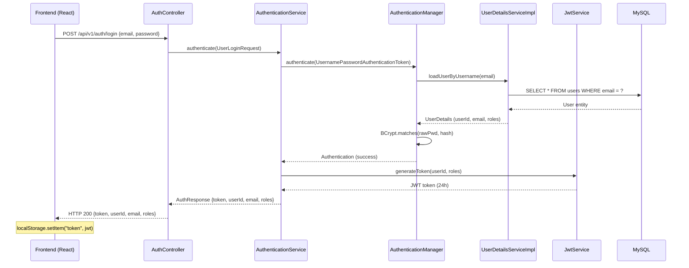
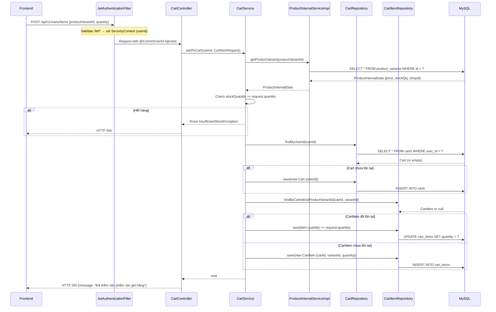
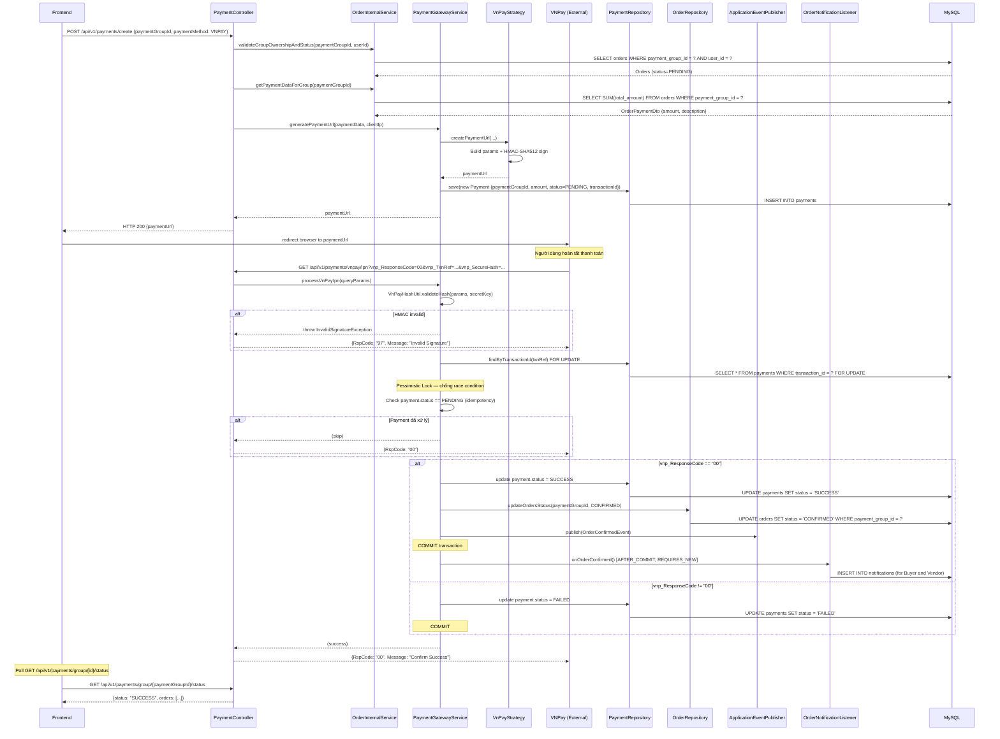
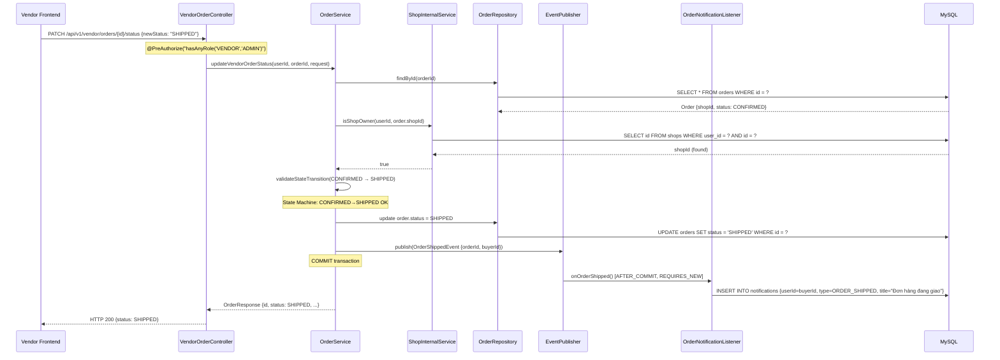
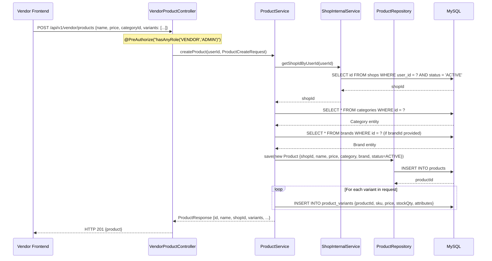
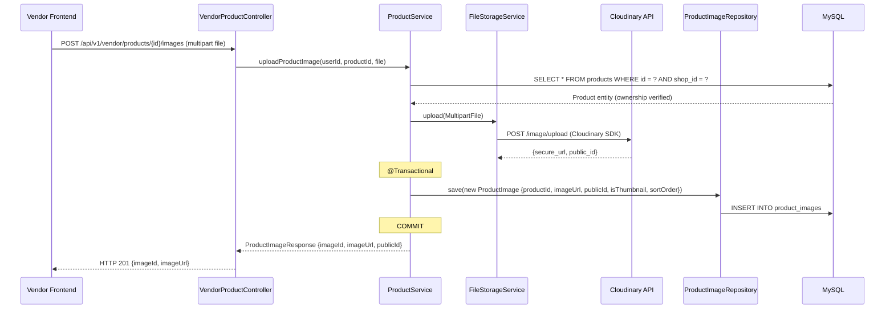
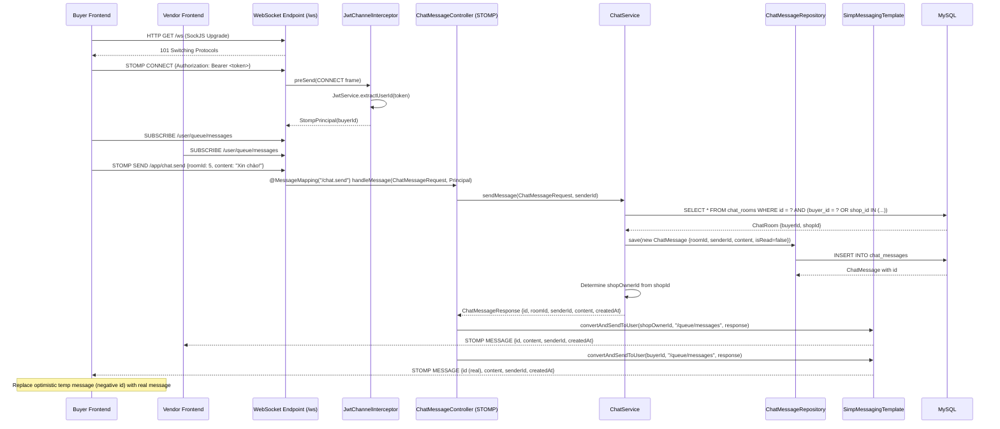

# SEQUENCE DIAGRAM SPECIFICATION

> Tài liệu này mô tả các sơ đồ tuần tự cho các luồng nghiệp vụ cốt lõi.
> Tất cả đều phản ánh implementation thực tế trong source code.

---

## SD01 — Đăng nhập (Login)

**Luồng:** Frontend → AuthController → AuthenticationService → UserDetailsServiceImpl → JwtService → DB



---

## SD02 — Thêm sản phẩm vào giỏ hàng (Add to Cart)

**Luồng:** Frontend → CartController → CartService → ProductInternalService → CartRepository → DB



---

## SD03 — Đặt hàng (Checkout)

**Luồng:** Frontend → OrderController → OrderService → ProductInternalService + VoucherInternalService → OrderRepository → DB

```mermaid
sequenceDiagram
    participant FE as Frontend
    participant OC as OrderController
    participant OS as OrderService
    participant PIS as ProductInternalService
    participant VIS as VoucherInternalService
    participant OR as OrderRepository
    participant PR as ProductVariantRepo
    participant DB as MySQL

    FE->>OC: POST /api/v1/orders/checkout {cartItemIds, shippingAddress, paymentMethod, voucherCodes}
    OC->>OS: checkout(userId, CheckoutRequest)

    Note over OS: @Transactional BEGIN

    loop For each cartItemId
        OS->>PIS: getProductVariant(variantId)
        PIS->>DB: SELECT * FROM product_variants WHERE id = ?
        DB-->>PIS: variant {price, stockQty, shopId}
        PIS-->>OS: ProductInternalData

        OS->>OS: Check stockQty >= qty
        alt Hết hàng
            OS-->>OC: throw InsufficientStockException
            Note over OS: ROLLBACK
            OC-->>FE: HTTP 400
        end
    end

    OS->>VIS: calculateDiscount(VoucherCalculationRequest)
    VIS->>DB: SELECT * FROM vouchers WHERE code IN (?) FOR UPDATE
    DB-->>VIS: Voucher entities
    VIS->>VIS: Validate (scope, dates, usageLimit, minOrderValue)
    VIS-->>OS: VoucherDiscountResult {discountByShop}

    OS->>OS: Group CartItems by shopId → N orders

    loop For each shop group
        OS->>OR: save(new Order {userId, shopId, paymentGroupId, status=PENDING, items...})
        OR->>DB: INSERT INTO orders; INSERT INTO order_items
    end

    loop For each variant
        OS->>PR: decrementStock(variantId, qty)
        PR->>DB: UPDATE product_variants SET stock_quantity = stock_quantity - ? WHERE id = ?
    end

    OS->>DB: UPDATE vouchers SET used_count = used_count + 1 WHERE code = ?
    OS->>DB: DELETE FROM cart_items WHERE id IN (?)

    Note over OS: COMMIT

    OS-->>OC: CheckoutResponse {paymentGroupId, orderIds, totalAmount}
    OC-->>FE: HTTP 201 {paymentGroupId, orderIds, totalAmount}
```

---

## SD04 — Thanh toán VNPay (Payment Flow)

**Luồng 2 giai đoạn:** (1) Tạo URL → (2) VNPay IPN callback



---

## SD05 — Vendor cập nhật trạng thái đơn hàng

**Luồng:** VendorOrderController → OrderService → ShopInternalService → State Machine → EventPublisher → NotificationListener



---

## SD06 — Thêm sản phẩm (Vendor)

**Luồng:** VendorProductController → ProductService → ShopInternalService → ProductRepository → DB



---

## SD07 — Upload ảnh sản phẩm

**Luồng:** VendorProductController → ProductService → FileStorageService → Cloudinary (External) → DB



---

## SD08 — Chat realtime (WebSocket STOMP)

**Luồng:** Frontend WebSocket → ChatMessageController (STOMP) → ChatService → DB → messagingTemplate → Frontend



---

## Tóm tắt sequence diagrams

| SD | Tên | Actors | External System |
|---|---|---|---|
| SD01 | Đăng nhập | Frontend, AuthController, AuthService, JwtService, DB | — |
| SD02 | Thêm vào giỏ | Frontend, CartController, CartService, ProductInternalService, DB | — |
| SD03 | Checkout | Frontend, OrderController, OrderService, ProductInternalService, VoucherInternalService, DB | — |
| SD04 | Thanh toán VNPay | Frontend, PaymentController, OrderInternalService, PaymentGatewayService, VNPay, DB | VNPay |
| SD05 | Cập nhật đơn (Vendor) | VendorFE, VendorOrderController, OrderService, ShopInternalService, EventPublisher, DB | — |
| SD06 | Thêm sản phẩm (Vendor) | VendorFE, VendorProductController, ProductService, ShopInternalService, DB | — |
| SD07 | Upload ảnh | VendorFE, VendorProductController, ProductService, FileStorageService, Cloudinary, DB | Cloudinary |
| SD08 | Chat realtime | BuyerFE, VendorFE, WebSocket, JwtInterceptor, ChatMessageController, ChatService, DB | — |
