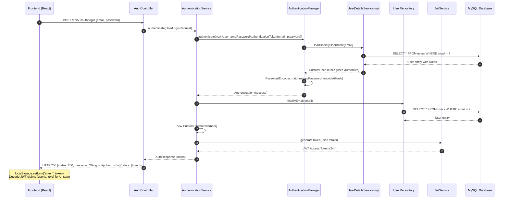
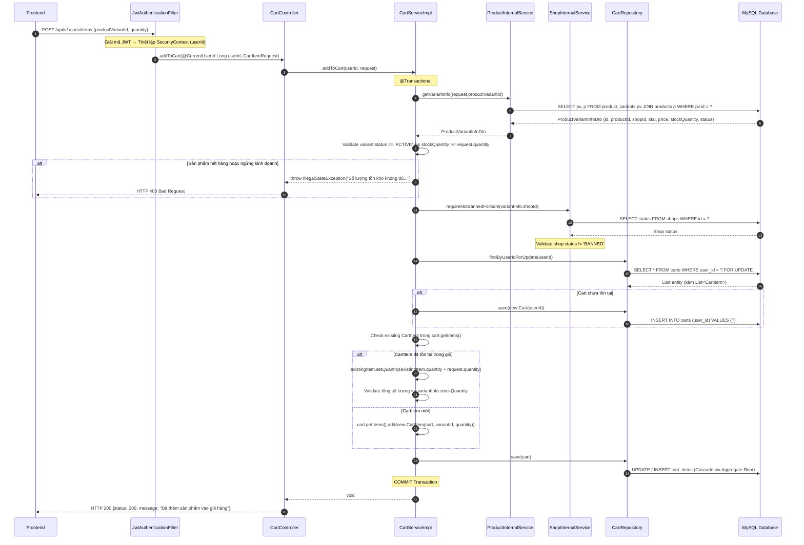
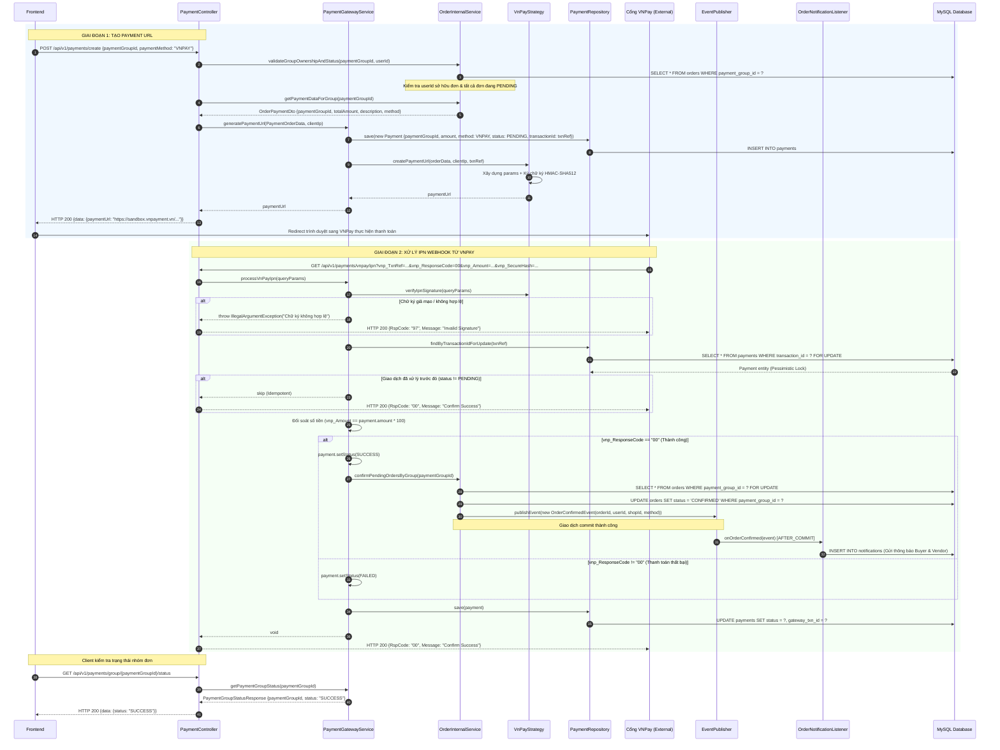
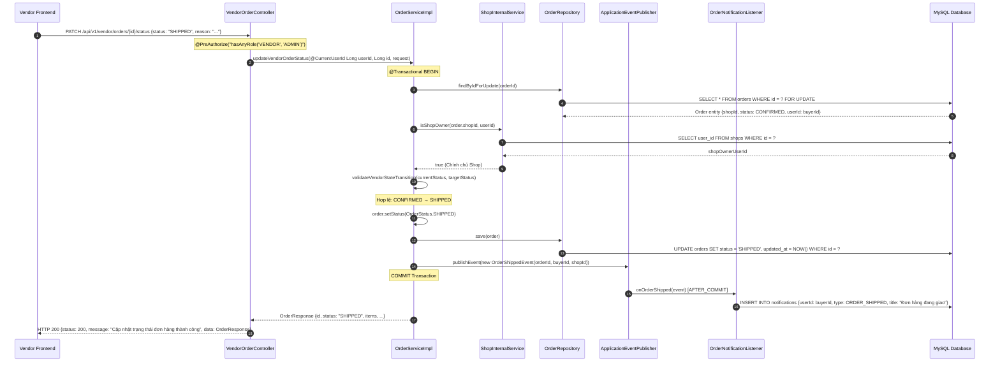
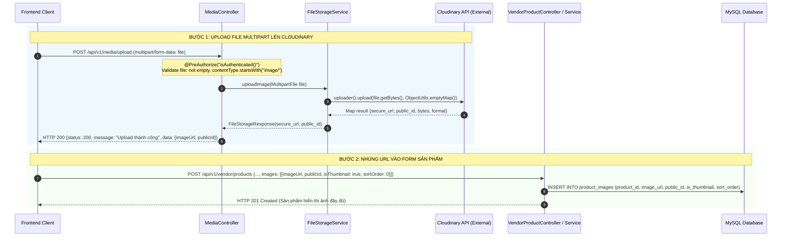
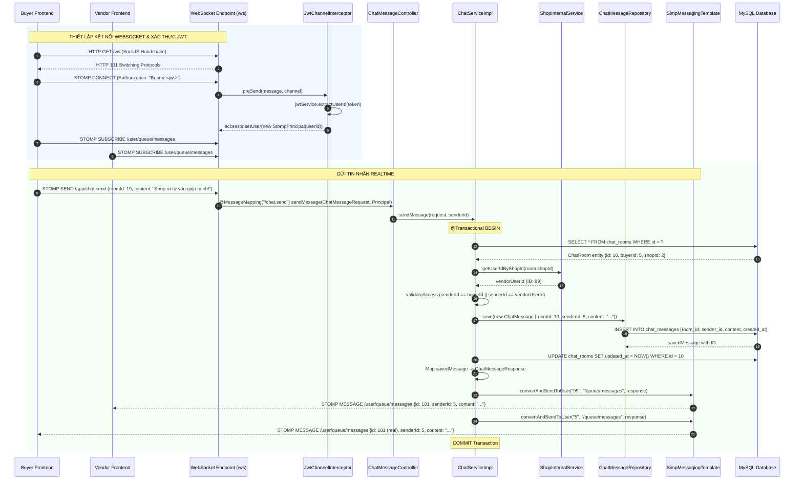
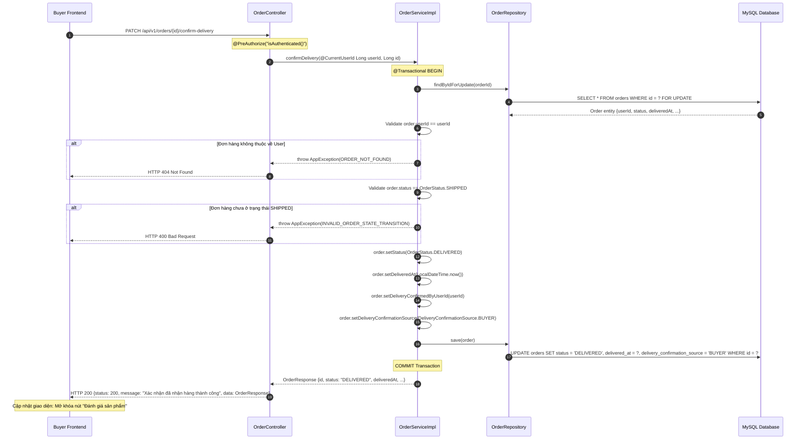
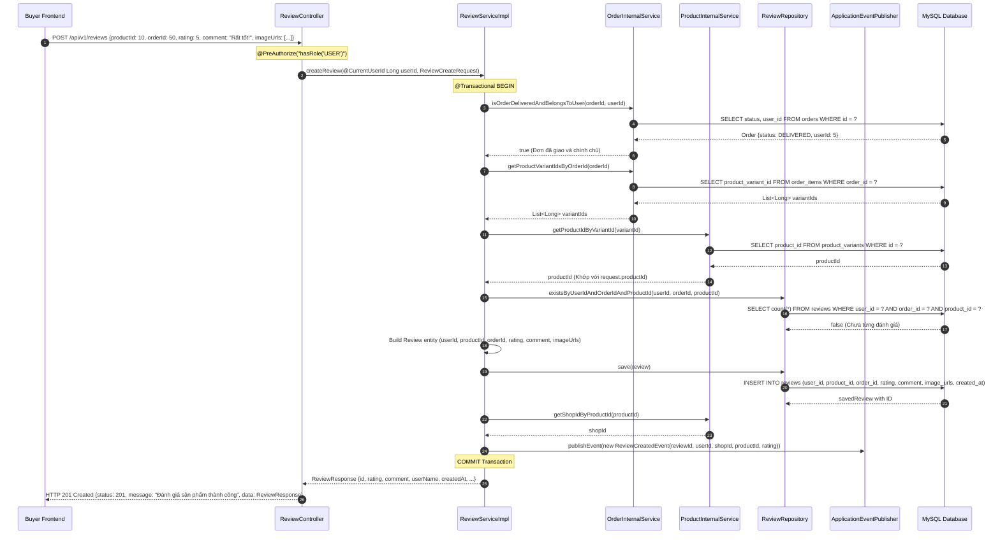

# SEQUENCE DIAGRAM SPECIFICATION

> Tài liệu này mô tả chi tiết các sơ đồ tuần tự (Sequence Diagrams) cho các luồng nghiệp vụ cốt lõi của hệ thống.
> Toàn bộ các sơ đồ phản ánh **100% mã nguồn thực tế** và tuân thủ nghiêm ngặt nguyên tắc **Modular Monolith** (giao tiếp liên module thông qua Internal Service & DTO, không truy cập trực tiếp Entity/Repository của module khác).

---

## Danh mục sơ đồ tuần tự

| Mã SD | Tên luồng nghiệp vụ | Module liên quan | Giao thức / Phương thức |
|---|---|---|---|
| **SD01** | Đăng nhập hệ thống (Login) | identity | REST / POST |
| **SD02** | Thêm sản phẩm vào giỏ hàng (Add to Cart) | cart, product, shop | REST / POST |
| **SD03** | Đặt hàng nhiều Shop (Checkout) | order, cart, product, voucher, shop | REST / POST |
| **SD04** | Thanh toán VNPay & Xử lý IPN Webhook | payment, order, notification | REST / External Gateway |
| **SD05** | Vendor cập nhật trạng thái đơn hàng | order, shop, notification | REST / PATCH |
| **SD06** | Vendor đăng sản phẩm mới kèm biến thể | product, shop | REST / POST |
| **SD07** | Upload ảnh Cloudinary độc lập (Decoupled Media) | media, product | REST / Multipart |
| **SD08** | Nhắn tin Realtime 2 chiều (STOMP over WebSocket) | chat, shop | WebSocket / STOMP |
| **SD09** | Người mua xác nhận đã nhận hàng (Confirm Delivery) | order | REST / PATCH |
| **SD10** | Đánh giá sản phẩm sau khi nhận hàng (Review) | review, order, product | REST / POST |

---

## SD01 — Đăng nhập (Login)

**Mô tả:** Người dùng gửi thông tin đăng nhập (`email`, `password`). Spring Security `AuthenticationManager` xác thực mật khẩu qua BCrypt. Sau khi hợp lệ, `JwtService` sinh JWT Token từ `CustomUserDetails`. Frontend lưu token vào `localStorage` và tự trích xuất thông tin người dùng từ JWT payload.



---

## SD02 — Thêm sản phẩm vào giỏ hàng (Add to Cart)

**Mô tả:** Khách hàng thêm một biến thể sản phẩm vào giỏ. `CartService` gọi `ProductInternalService` để kiểm tra tồn kho, trạng thái `ACTIVE` và gọi `ShopInternalService` kiểm tra Shop không bị khóa. Giỏ hàng được khóa ghi (`findByUserIdForUpdate`) để xử lý an toàn đồng thời. `CartItem` được quản lý theo mô hình Aggregate Root trong `Cart`.



---

## SD03 — Đặt hàng nhiều Shop (Checkout)

**Mô tả:** Khách hàng thanh toán giỏ hàng. `OrderServiceImpl` tương tác với các module qua Internal Service (`CartInternalService`, `ProductInternalService`, `VoucherInternalService`, `ShopInternalService`). Đơn hàng được tự động gom nhóm theo Shop (`shopId`), trừ tồn kho biến thể, tăng lượt dùng voucher và xóa các item đã mua khỏi giỏ hàng.

```mermaid
sequenceDiagram
    autonumber
    participant FE as Frontend
    participant OC as OrderController
    participant OS as OrderServiceImpl
    participant CIS as CartInternalService
    participant SIS as ShopInternalService
    participant PIS as ProductInternalService
    participant VIS as VoucherInternalService
    participant OR as OrderRepository
    participant DB as MySQL Database

    FE->>OC: POST /api/v1/orders/checkout {cartItemIds, shippingAddress, paymentMethod, voucherCode}
    OC->>OS: checkout(@CurrentUserId Long userId, CheckoutRequest)

    Note over OS: @Transactional BEGIN
    OS->>CIS: getCartItems(userId)
    CIS->>DB: SELECT * FROM cart_items ci JOIN carts c ON ci.cart_id = c.id WHERE c.user_id = ?
    DB-->>CIS: List<CartItemInternalDto>
    CIS-->>OS: List<CartItemInternalDto>

    OS->>OS: Lọc các items theo request.cartItemIds (hoặc lấy tất cả nếu rỗng)
    OS->>SIS: requireNotBannedForSale(shopId) [cho từng shop liên quan]

    opt Có voucherCode áp dụng
        OS->>VIS: calculateDiscount(new VoucherCalculationRequest(voucherCode, shopTotals))
        VIS->>DB: SELECT * FROM vouchers WHERE code = ? FOR UPDATE
        DB-->>VIS: Voucher entity
        VIS->>VIS: Validate điều kiện (minOrderValue, validity, usageLimit)
        VIS-->>OS: VoucherDiscountResult {voucherId, code, discountPerShop}
        OS->>VIS: incrementUsage(voucherDiscount.voucherId)
        VIS->>DB: UPDATE vouchers SET used_count = used_count + 1 WHERE id = ?
    end

    OS->>OS: Group CartItems theo shopId (N shop = N đơn hàng)
    OS->>OS: Sinh paymentGroupId chung = UUID.randomUUID()

    loop Cho từng nhóm Shop
        OS->>OS: Tạo Order {userId, shopId, paymentGroupId, status: PENDING, shippingAddress...}
        loop Cho từng item của Shop
            OS->>PIS: deductStock(variantId, quantity)
            PIS->>DB: UPDATE product_variants SET stock_quantity = stock_quantity - ? WHERE id = ? AND stock_quantity >= ?
            OS->>OS: order.addOrderItem(new OrderItem(...))
        end
        OS->>OS: order.setOriginalTotalAmount(), order.setDiscountAmount(), order.setTotalAmount()
        OS->>OR: save(order)
        OR->>DB: INSERT INTO orders; INSERT INTO order_items (Cascade)
    end

    OS->>CIS: removeCartItems(userId, checkedOutItemIds)
    CIS->>DB: DELETE FROM cart_items WHERE cart_id = ? AND id IN (?)

    Note over OS: COMMIT Transaction
    OS-->>OC: CheckoutResponse {paymentGroupId, orders: List<OrderResponse>}
    OC-->>FE: HTTP 200 {status: 200, message: "Đặt hàng thành công", data: CheckoutResponse}
```

---

## SD04 — Thanh toán VNPay & Xử lý IPN Webhook

**Mô tả:** Quy trình gồm 2 giai đoạn:
1. **Khởi tạo thanh toán:** Sinh mã giao dịch duy nhất `txnRef`, lưu record `Payment (PENDING)`, sinh URL thanh toán có chữ ký HMAC-SHA512 để redirect người dùng sang cổng VNPay.
2. **Xử lý IPN Webhook:** VNPay gọi Webhook ngầm `GET /api/v1/payments/vnpay/ipn`. `PaymentGatewayService` đối soát chữ ký, dùng Pessimistic Lock khóa record `Payment`, kiểm tra chống lặp giao dịch (Idempotency) và đối soát số tiền `vnp_Amount`. Khi hợp lệ, gọi `OrderInternalService` xác nhận đơn và bắn `OrderConfirmedEvent` để gửi thông báo.



---

## SD05 — Vendor cập nhật trạng thái đơn hàng

**Mô tả:** Người bán (`VENDOR`) chuyển trạng thái đơn hàng (ví dụ: `CONFIRMED` $\rightarrow$ `SHIPPED`). Hệ thống xác thực quyền sở hữu Shop qua `ShopInternalService`, xác thực tính hợp lệ của máy trạng thái (`State Machine`), cập nhật trạng thái đơn và phát sự kiện `OrderShippedEvent` để gửi thông báo cho Buyer.



---

## SD06 — Thêm sản phẩm mới kèm biến thể (Vendor)

**Mô tả:** Người bán đăng sản phẩm mới. `ProductServiceImpl` xác thực danh mục `Category`, xác thực quyền sở hữu Shop qua `ShopInternalService` và đảm bảo Shop không bị cấm bán. Sản phẩm được lưu xuống DB, sau đó toàn bộ biến thể (`ProductVariant`) được tạo và lưu hàng loạt (`saveAll`).

```mermaid
sequenceDiagram
    autonumber
    participant VFE as Vendor Frontend
    participant VPC as VendorProductController
    participant PS as ProductServiceImpl
    participant SIS as ShopInternalService
    participant CR as CategoryRepository
    participant PR as ProductRepository
    participant PVR as ProductVariantRepository
    participant DB as MySQL Database

    VFE->>VPC: POST /api/v1/vendor/products {name, price, stockQuantity, categoryId, images: [...], variants: [...]}
    Note over VPC: @PreAuthorize("hasAnyRole('VENDOR', 'ADMIN')")
    VPC->>PS: createProduct(@CurrentUserId Long userId, ProductCreateRequest)

    Note over PS: @Transactional BEGIN
    PS->>CR: findById(request.categoryId)
    CR->>DB: SELECT * FROM categories WHERE id = ?
    DB-->>CR: Category entity

    PS->>SIS: getShopIdByUserId(userId)
    SIS->>DB: SELECT id FROM shops WHERE user_id = ?
    DB-->>SIS: shopId
    SIS-->>PS: shopId

    PS->>SIS: requireNotBannedForSale(shopId)
    SIS->>DB: SELECT status FROM shops WHERE id = ?
    DB-->>SIS: ACTIVE

    PS->>PS: Build Product entity (shopId, name, price, stockQuantity, category, status: ACTIVE)
    opt Có danh sách ảnh truyền lên
        PS->>PS: Map request.images -> List<ProductImage> (gán product, normalize thumbnail & sortOrder)
    end

    PS->>PR: save(product)
    PR->>DB: INSERT INTO products; INSERT INTO product_images
    DB-->>PR: savedProduct (có generated id)

    opt Có danh sách biến thể truyền lên
        PS->>PS: Map request.variants -> List<ProductVariant> (gán savedProduct, status: ACTIVE)
        PS->>PVR: saveAll(variantsToSave)
        PVR->>DB: Batch INSERT INTO product_variants
    end

    Note over PS: COMMIT Transaction
    PS-->>VPC: ProductResponse (id, name, price, images, variants...)
    VPC-->>VFE: HTTP 201 Created {status: 201, message: "Đăng sản phẩm thành công", data: ProductResponse}
```

---

## SD07 — Upload ảnh Cloudinary độc lập (Decoupled Media)

**Mô tả:** Kiến trúc upload ảnh của hệ thống được tách biệt 2 bước (Decoupled):
1. **Upload ảnh tĩnh:** Client gửi file Multipart lên `MediaController`. `FileStorageService` đẩy ảnh trực tiếp lên Cloudinary CDN và nhận về URL an toàn cùng `publicId`.
2. **Lưu trữ nghiệp vụ:** Client sử dụng `imageUrl` và `publicId` này để nhúng vào payload tạo sản phẩm (`ProductCreateRequest`), lưu avatar hoặc đánh giá.



---

## SD08 — Nhắn tin Realtime 2 chiều (STOMP over WebSocket)

**Mô tả:** Luồng trao đổi tin nhắn thời gian thực giữa Khách mua (`Buyer`) và Chủ shop (`Vendor`):
1. **Xác thực kết nối:** Khách kết nối WebSocket qua SockJS (`/ws`). `JwtChannelInterceptor` chặn frame STOMP `CONNECT`, trích xuất `userId` từ Bearer Token để gán `StompPrincipal`.
2. **Gửi & Chuyển phát tin nhắn:** Client gửi frame STOMP đến `/app/chat.send`. `ChatMessageController` chuyển tiếp sang `ChatServiceImpl`. Dịch vụ lưu tin nhắn vào MySQL và trực tiếp dùng `SimpMessagingTemplate` để đẩy tin nhắn qua destination riêng `/user/queue/messages` đến **cả người nhận và người gửi** (đảm bảo đồng bộ đa thiết bị).



---

## SD09 — Người mua xác nhận đã nhận hàng (Confirm Delivery)

**Mô tả:** Khi đơn hàng ở trạng thái `SHIPPED`, người mua nhấn "Đã nhận hàng" trên giao diện. `OrderServiceImpl` kiểm tra quyền sở hữu, khóa đơn (`findByIdForUpdate`), chuyển trạng thái sang `DELIVERED`, lưu thời gian giao hàng `deliveredAt` và ghi nhận người xác nhận là `DeliveryConfirmationSource.BUYER`.



---

## SD10 — Đánh giá sản phẩm sau khi nhận hàng (Review)

**Mô tả:** Khách hàng đánh giá sản phẩm sau khi đơn hàng hoàn tất. `ReviewServiceImpl` giao tiếp với `OrderInternalService` để kiểm tra đơn hàng đã giao thành công và thuộc về khách hàng. Sau đó kiểm tra tính hợp lệ của sản phẩm trong đơn qua `ProductInternalService`, lưu đánh giá vào DB và bắn `ReviewCreatedEvent` để cập nhật thống kê/gửi thông báo.


