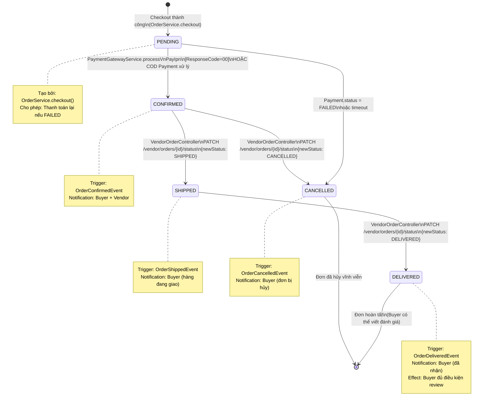
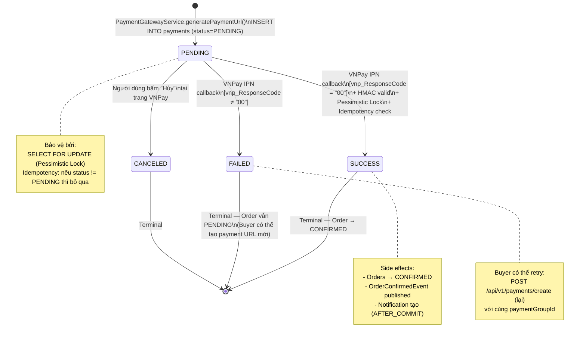
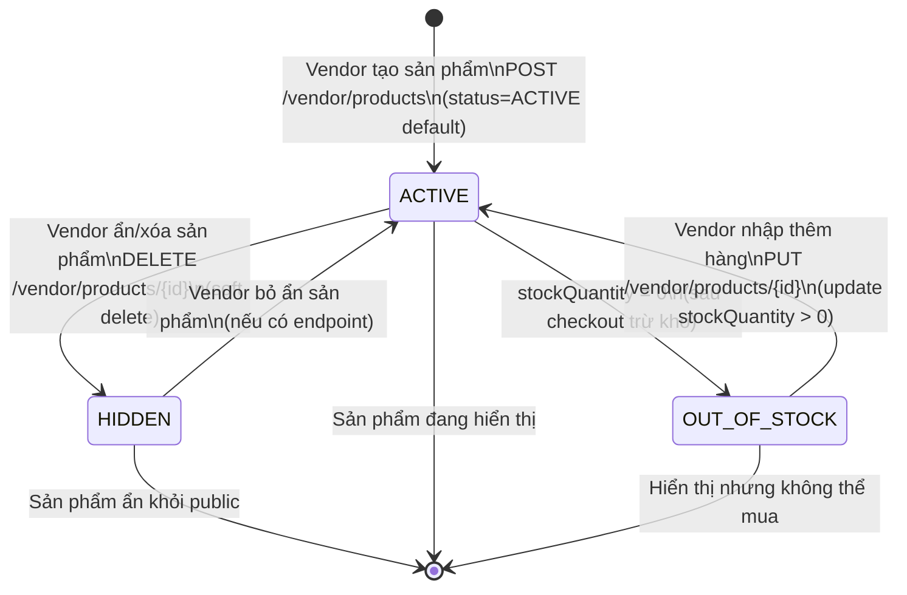

# STATE DIAGRAM SPECIFICATION

> Mô tả sơ đồ trạng thái dựa trên source code thực tế.
> Các transition đều có bằng chứng trong Entity enum và Service logic.

---

## ST01 — Trạng thái Đơn hàng (Order Status)

**Enum:** `com.tmt.ecommerce.order.entity.OrderStatus`
**Values:** `PENDING, CONFIRMED, SHIPPED, DELIVERED, CANCELLED`

### 5 trạng thái:

| Trạng thái | Mô tả |
|---|---|
| `PENDING` | Đơn vừa được tạo, chờ thanh toán xác nhận |
| `CONFIRMED` | Thanh toán thành công (VNPay IPN hoặc COD), gian hàng đã nhận đơn |
| `SHIPPED` | Gian hàng đã giao cho đơn vị vận chuyển |
| `DELIVERED` | Khách đã nhận hàng thành công |
| `CANCELLED` | Đơn bị hủy (Vendor hủy khi còn CONFIRMED, hoặc hệ thống hủy khi payment FAILED) |

### State Machine Diagram:



### Quy tắc chuyển trạng thái (State Machine):

| From | To | Cho phép | Actor | Bằng chứng |
|---|---|---|---|---|
| PENDING | CONFIRMED | ✅ | System (IPN) / COD | `PaymentGatewayService.processVnPayIpn()` |
| PENDING | CANCELLED | ✅ | System (payment failed) | IPN ResponseCode ≠ 00 |
| CONFIRMED | SHIPPED | ✅ | Vendor | `VendorOrderController.updateOrderStatus()` |
| CONFIRMED | CANCELLED | ✅ | Vendor | `VendorOrderController.updateOrderStatus()` |
| SHIPPED | DELIVERED | ✅ | Vendor | `VendorOrderController.updateOrderStatus()` |
| SHIPPED | CONFIRMED | ❌ | — | Invalid (backward) |
| DELIVERED | any | ❌ | — | Terminal state |
| CANCELLED | any | ❌ | — | Terminal state |

---

## ST02 — Trạng thái Thanh toán (Payment Status)

**Enum:** `com.tmt.ecommerce.payment.enums.PaymentStatus`
**Values:** `PENDING, SUCCESS, FAILED, CANCELED`

### 4 trạng thái:

| Trạng thái | Mô tả |
|---|---|
| `PENDING` | Payment record vừa được tạo, chờ người dùng hoàn tất tại cổng thanh toán |
| `SUCCESS` | VNPay IPN xác nhận thành công (ResponseCode=00) hoặc COD |
| `FAILED` | VNPay IPN báo thất bại (ResponseCode≠00) |
| `CANCELED` | Người dùng chủ động hủy giao dịch |

### State Machine Diagram:



### Idempotency Pattern:

```
IPN đến (lần 1): payment.status == PENDING → Xử lý bình thường → SUCCESS
IPN đến (lần 2): payment.status == SUCCESS → Bỏ qua → Trả RspCode=00
```

Đây là cơ chế chống xử lý trùng lặp khi VNPay gửi lại IPN nhiều lần.

---

## ST03 — Trạng thái Gian hàng (Shop Status)

**Enum:** `com.tmt.ecommerce.shop.enums.ShopStatus`
**Values:** `PENDING, ACTIVE, BANNED`

```mermaid
stateDiagram-v2
    [*] --> PENDING : User đăng ký mở gian hàng\nPOST /api/v1/shops

    PENDING --> ACTIVE : Admin phê duyệt\nPUT /admin/shops/{id}/approve
    Note right of ACTIVE: Side effects:\n- ShopApprovedEvent published\n- Email gửi (AFTER_COMMIT async)\n- User nhận ROLE_VENDOR

    PENDING --> BANNED : Admin từ chối/ban\n(manual process)

    ACTIVE --> BANNED : Admin ban shop\n(manual process)

    BANNED --> [*]
    ACTIVE --> [*] : Gian hàng đang hoạt động
```

### Quy tắc:
- Mỗi User chỉ có tối đa 1 Shop (`user_id UNIQUE` trong bảng `shops`).
- Chỉ Shop có status `ACTIVE` mới có thể đăng sản phẩm và nhận đơn.
- Khi Admin approve, Vendor chuyển sang `ROLE_VENDOR` (lưu trong `user_roles`).

---

## ST04 — Trạng thái Sản phẩm (Product Status)

**Enum:** `com.tmt.ecommerce.product.enums.ProductStatus`
**Values:** `ACTIVE, OUT_OF_STOCK, HIDDEN`



**Lưu ý:** `ProductVariant` cũng có `status: ProductStatus` (áp dụng tương tự cho từng biến thể).

---

## Tóm tắt State Machines

| Entity | Enum | Số trạng thái | Terminal States |
|---|---|---|---|
| Order | `OrderStatus` | 5 | DELIVERED, CANCELLED |
| Payment | `PaymentStatus` | 4 | SUCCESS, FAILED, CANCELED |
| Shop | `ShopStatus` | 3 | BANNED |
| Product | `ProductStatus` | 3 | HIDDEN (soft) |
