# USE CASE DIAGRAM SPECIFICATION

> Tài liệu này mô tả đầy đủ các Actor, Use Case, và mối quan hệ (Include, Extend, Generalization) để vẽ sơ đồ Use Case bằng Mermaid hoặc Draw.io.
> Toàn bộ các Use Case đều có bằng chứng trực tiếp từ Controller, Service và Event listener trong source code.

---

## 1. Actors

| ID | Tên Actor | Loại | Ký hiệu | Mô tả |
|---|---|---|---|---|
| A1 | Guest | Primary | Stick figure | Khách vãng lai chưa đăng nhập |
| A2 | Buyer | Primary | Stick figure | Người mua hàng đã đăng nhập (`ROLE_USER`) |
| A3 | Vendor | Primary | Stick figure | Chủ gian hàng đã được duyệt (`ROLE_VENDOR`) |
| A4 | Admin | Primary | Stick figure | Ban quản trị hệ thống (`ROLE_ADMIN`) |
| A5 | VNPay | Secondary (External System) | Rectangle «actor» | Cổng thanh toán trực tuyến |
| A6 | Cloudinary | Secondary (External System) | Rectangle «actor» | Dịch vụ lưu trữ và xử lý ảnh đám mây |
| A7 | Gmail SMTP | Secondary (External System) | Rectangle «actor» | Máy chủ gửi email thông báo |

**Phân cấp kế thừa Actor (Generalization):**
```
Guest ──────────────────── (Sử dụng các chức năng Public: UC01 - UC06)
  │
  └──> Buyer ──────────────── (Kế thừa Guest + Mua sắm, Giỏ hàng, Đơn hàng: UC07 - UC26)
         │
         └──> Vendor ─────── (Kế thừa Buyer + Quản lý gian hàng, Sản phẩm, Xử lý đơn: UC27 - UC40)
```
*Ghi chú:* Chủ shop (Vendor) vẫn có đầy đủ quyền hạn của một người mua (Buyer) bình thường.

---

## 2. System Boundary

**Tên hệ thống:** `Enterprise Ecommerce System`

---

## 3. Use Cases theo nhóm nghiệp vụ

### Nhóm 1: Quản lý tài khoản & Xác thực

| UC ID | Tên Use Case | Actor(s) | Endpoint / Service liên quan |
|---|---|---|---|
| UC01 | Đăng ký tài khoản | A1 (Guest) | `POST /api/v1/auth/register` |
| UC02 | Đăng nhập hệ thống | A1, A2, A3, A4 | `POST /api/v1/auth/login` |

### Nhóm 2: Danh mục & Sản phẩm (Public)

| UC ID | Tên Use Case | Actor(s) | Endpoint / Service liên quan |
|---|---|---|---|
| UC03 | Xem danh sách sản phẩm | A1, A2 | `GET /api/v1/products` |
| UC04 | Tìm kiếm & lọc sản phẩm | A1, A2 | `GET /api/v1/products/search` |
| UC05 | Xem chi tiết sản phẩm | A1, A2 | `GET /api/v1/products/{id}` |
| UC06 | Xem đánh giá sản phẩm | A1, A2 | `GET /api/v1/reviews/product/{id}` |

### Nhóm 3: Mua sắm & Quản lý đơn hàng (Buyer)

| UC ID | Tên Use Case | Actor(s) | Endpoint / Service liên quan |
|---|---|---|---|
| UC07 | Thêm sản phẩm vào giỏ | A2 (Buyer) | `POST /api/v1/cart/items` |
| UC08 | Cập nhật số lượng trong giỏ | A2 | `PUT /api/v1/cart/items/{id}` |
| UC09 | Xóa sản phẩm khỏi giỏ | A2 | `DELETE /api/v1/cart/items/{id}` |
| UC10 | Xem giỏ hàng | A2 | `GET /api/v1/cart` |
| UC11 | Xem trước tổng giá trị đơn (Preview Checkout) | A2 | `POST /api/v1/orders/preview` |
| UC12 | Đặt hàng (Checkout) | A2 | `POST /api/v1/orders/checkout` |
| UC13 | Thanh toán qua cổng VNPay | A2, A5 | `POST /api/v1/payments/create-url` |
| UC14 | Thanh toán khi nhận hàng (COD) | A2 | `POST /api/v1/orders/checkout (method=COD)` |
| UC15 | Xem trạng thái thanh toán | A2 | `GET /api/v1/payments/group/{id}/status` |
| UC16 | Xem lịch sử đơn hàng | A2 | `GET /api/v1/orders` |
| UC17 | Xem chi tiết đơn hàng | A2 | `GET /api/v1/orders/{id}` |
| UC18 | Hủy đơn hàng (khi PENDING) | A2 | `PATCH /api/v1/orders/{id}/cancel` |
| UC19 | Xác nhận đã nhận hàng (khi SHIPPED) | A2 | `PATCH /api/v1/orders/{id}/confirm-delivery` |
| UC20 | Viết đánh giá sản phẩm | A2 | `POST /api/v1/reviews` (yêu cầu DELIVERED) |
| UC21 | Sửa đánh giá đã viết | A2 | `PUT /api/v1/reviews/{id}` |
| UC22 | Xóa đánh giá | A2 | `DELETE /api/v1/reviews/{id}` |
| UC23 | Áp dụng mã giảm giá (Voucher) | A2 | Tích hợp trong Preview & Checkout |
| UC24 | Nhắn tin thời gian thực với Shop | A2, A3 | WebSocket `/app/chat.send` |
| UC25 | Nhận thông báo trong ứng dụng | A2, A3 | WebSocket `/user/queue/notifications` |

### Nhóm 4: Quản lý gian hàng (Vendor)

| UC ID | Tên Use Case | Actor(s) | Endpoint / Service liên quan |
|---|---|---|---|
| UC26 | Đăng ký mở gian hàng | A2 (trở thành A3 sau duyệt) | `POST /api/v1/shops/register` |
| UC27 | Xem thông tin gian hàng | A3 (Vendor) | `GET /api/v1/shops/my-shop` |
| UC28 | Thêm sản phẩm mới | A3 | `POST /api/v1/vendor/products` |
| UC29 | Cập nhật thông tin & biến thể sản phẩm | A3 | `PUT /api/v1/vendor/products/{id}` |
| UC30 | Ẩn / khôi phục / xóa sản phẩm | A3 | `PATCH /api/v1/vendor/products/{id}/status` |
| UC31 | Upload ảnh sản phẩm lên Cloudinary | A3, A6 | `POST /api/v1/vendor/products/{id}/images` |
| UC32 | Xóa ảnh sản phẩm | A3, A6 | `DELETE /api/v1/vendor/products/images/{id}` |
| UC33 | Xem danh sách đơn hàng gian hàng | A3 | `GET /api/v1/vendor/orders` |
| UC34 | Xem chi tiết đơn hàng gian hàng | A3 | `GET /api/v1/vendor/orders/{id}` |
| UC35 | Xác nhận đơn hàng (PENDING → CONFIRMED) | A3 | `PATCH /api/v1/vendor/orders/{id}/status` |
| UC36 | Cập nhật trạng thái đơn (Giao hàng / Hủy) | A3 | `PATCH /api/v1/vendor/orders/{id}/status` |
| UC37 | Phản hồi đánh giá của khách | A3 | `POST /api/v1/vendor/reviews/{id}/reply` |
| UC38 | Tạo mã giảm giá của gian hàng | A3 | `POST /api/v1/vendor/vouchers` |
| UC39 | Xem danh sách voucher gian hàng | A3 | `GET /api/v1/vendor/vouchers` |
| UC40 | Nhắn tin với khách hàng (realtime) | A3, A2 | WebSocket `/app/chat.send` |

### Nhóm 5: Quản trị hệ thống (Admin)

| UC ID | Tên Use Case | Actor(s) | Endpoint / Service liên quan |
|---|---|---|---|
| UC41 | Xem danh sách gian hàng | A4 (Admin) | `GET /api/v1/admin/shops` |
| UC42 | Phê duyệt gian hàng | A4, A7 | `POST /api/v1/admin/shops/{id}/approve` |
| UC43 | Khóa / Mở khóa gian hàng (Ban / Unban) | A4 | `PATCH /api/v1/admin/shops/{id}/ban` & `/unban` |
| UC44 | Xem đơn hàng toàn hệ thống | A4 | `GET /api/v1/admin/orders` |
| UC45 | Xem chi tiết đơn hàng quản trị | A4 | `GET /api/v1/admin/orders/{id}` |
| UC46 | Can thiệp trạng thái đơn hàng (Audit status) | A4 | `PATCH /api/v1/admin/orders/{id}/status` |
| UC47 | Tạo voucher hệ thống toàn sàn | A4 | `POST /api/v1/admin/vouchers` |
| UC48 | Quản lý danh mục sản phẩm toàn sàn | A4 | `POST/PUT /api/v1/categories` |

### Nhóm 6: Hệ thống / Tích hợp ngoài (System & External)

| UC ID | Tên Use Case | Actor(s) | Cơ chế kỹ thuật |
|---|---|---|---|
| UC49 | Xử lý IPN Webhook VNPay | A5 (VNPay) | `GET /api/v1/payments/vnpay-ipn` (Idempotent) |
| UC50 | Gửi email thông báo duyệt gian hàng | A7 (Gmail SMTP) | Spring `JavaMailSender` (`@Async`) |
| UC51 | Tạo thông báo sự kiện (In-App) | System | `TransactionalEventListener(AFTER_COMMIT)` |
| UC52 | Đẩy thông báo thời gian thực | System | STOMP WebSocket `SimpMessagingTemplate` |

---

## 4. Mối quan hệ Include / Extend / Generalization

### 4.1. Quan hệ «include» (Bắt buộc phải thực hiện kèm theo)

| Use Case chính | «include» Use Case | Giải thích nghiệp vụ |
|---|---|---|
| UC12 (Đặt hàng) | UC11 (Preview Checkout) | Khi đặt hàng, hệ thống luôn phải tính toán lại giá, kho và phí |
| UC12 (Đặt hàng) | UC23 (Áp dụng voucher) | Đơn hàng luôn kiểm tra và trừ chiết khấu nếu có voucher hợp lệ |
| UC42 (Duyệt gian hàng) | UC50 (Gửi email) | Khi Admin duyệt shop, hệ thống bắt buộc gửi email chúc mừng qua SMTP |
| UC35, UC36 (Xử lý đơn) | UC51 (Tạo thông báo sự kiện) | Đơn hàng đổi trạng thái tự động sinh bản ghi thông báo tương ứng |
| UC20 (Viết đánh giá) | UC51 (Tạo thông báo sự kiện) | Khách viết đánh giá sẽ tạo thông báo gửi đến chủ shop |
| UC51 (Tạo thông báo sự kiện) | UC52 (Đẩy realtime WebSocket) | Thông báo sau khi lưu DB sẽ được bắn ngay lập tức qua WebSocket |

### 4.2. Quan hệ «extend» (Mở rộng có điều kiện)

| Use Case mở rộng | «extend» Use Case cơ sở | Điều kiện kích hoạt (Extension Point) |
|---|---|---|
| UC18 (Hủy đơn hàng) | UC16 (Xem lịch sử đơn) | Chỉ khi đơn hàng đang ở trạng thái `PENDING` ("Chờ xác nhận") |
| UC19 (Xác nhận đã nhận hàng) | UC16 (Xem lịch sử đơn) | Chỉ khi đơn hàng đang ở trạng thái `SHIPPED` ("Đang giao") |
| UC20 (Viết đánh giá sản phẩm) | UC19 (Xác nhận đã nhận hàng) | Chỉ khi đơn hàng đã chuyển sang `DELIVERED` ("Hoàn thành") |
| UC21 (Sửa đánh giá) | UC20 (Viết đánh giá) | Chỉ sửa được đánh giá do chính tài khoản mình viết |
| UC22 (Xóa đánh giá) | UC20 (Viết đánh giá) | Chỉ xóa được đánh giá do chính tài khoản mình viết |
| UC37 (Phản hồi đánh giá) | UC06 (Xem đánh giá) | Chỉ kích hoạt khi Actor là chủ sở hữu của shop có sản phẩm được đánh giá |
| UC43 (Khóa/Mở khóa shop) | UC41 (Xem danh sách shop) | Chỉ khi phát hiện gian hàng có dấu hiệu vi phạm chính sách |

---

## 5. Mermaid Use Case Diagram

```mermaid
graph TB
    %% Actors
    Guest([Guest])
    Buyer([Buyer])
    Vendor([Vendor])
    Admin([Admin])
    VNPay([«actor» VNPay])
    Cloudinary([«actor» Cloudinary])
    Gmail([«actor» Gmail SMTP])

    %% System boundary
    subgraph System["Enterprise Ecommerce System"]

        %% Account
        UC01[UC01: Đăng ký tài khoản]
        UC02[UC02: Đăng nhập]

        %% Public
        UC03[UC03: Xem sản phẩm]
        UC04[UC04: Tìm kiếm & Lọc]
        UC05[UC05: Xem chi tiết SP]
        UC06[UC06: Xem đánh giá SP]

        %% Buyer Shopping
        UC07[UC07: Thêm vào giỏ]
        UC10[UC10: Xem giỏ hàng]
        UC11[UC11: Xem trước đơn hàng]
        UC12[UC12: Đặt hàng - Checkout]
        UC13[UC13: Thanh toán VNPay]
        UC14[UC14: Thanh toán COD]
        UC16[UC16: Lịch sử đơn hàng]
        UC18[UC18: Hủy đơn PENDING]
        UC19[UC19: Xác nhận nhận hàng]
        UC20[UC20: Viết đánh giá]
        UC23[UC23: Áp dụng voucher]
        UC24[UC24: Chat thời gian thực]
        UC25[UC25: Nhận thông báo]

        %% Vendor
        UC26[UC26: Đăng ký gian hàng]
        UC28[UC28: Thêm sản phẩm]
        UC31[UC31: Upload ảnh sản phẩm]
        UC33[UC33: Xem đơn hàng shop]
        UC35[UC35: Xác nhận đơn COD]
        UC36[UC36: Cập nhật giao / hủy]
        UC37[UC37: Phản hồi đánh giá]
        UC38[UC38: Tạo voucher shop]

        %% Admin
        UC41[UC41: Quản lý gian hàng]
        UC42[UC42: Phê duyệt gian hàng]
        UC43[UC43: Khóa/Mở khóa shop]
        UC44[UC44: Xem đơn toàn sàn]
        UC46[UC46: Can thiệp trạng thái đơn]
        UC47[UC47: Tạo voucher hệ thống]
        UC48[UC48: Quản lý danh mục SP]

        %% External / System Actions
        UC49[UC49: Nhận IPN Webhook]
        UC50[UC50: Gửi email duyệt shop]
        UC51[UC51: Tạo thông báo sự kiện]
        UC52[UC52: Đẩy WebSocket realtime]
    end

    %% Guest associations
    Guest --> UC01
    Guest --> UC02
    Guest --> UC03
    Guest --> UC04
    Guest --> UC05
    Guest --> UC06

    %% Buyer associations
    Buyer --> UC02
    Buyer --> UC07
    Buyer --> UC10
    Buyer --> UC12
    Buyer --> UC13
    Buyer --> UC14
    Buyer --> UC16
    Buyer --> UC24
    Buyer --> UC25
    Buyer --> UC26

    %% Vendor associations
    Vendor --> UC28
    Vendor --> UC31
    Vendor --> UC33
    Vendor --> UC35
    Vendor --> UC36
    Vendor --> UC37
    Vendor --> UC38
    Vendor --> UC24
    Vendor --> UC25

    %% Admin associations
    Admin --> UC41
    Admin --> UC42
    Admin --> UC43
    Admin --> UC44
    Admin --> UC46
    Admin --> UC47
    Admin --> UC48

    %% External Systems
    VNPay --> UC49
    Gmail --> UC50
    Cloudinary --> UC31

    %% Include relationships
    UC12 -.->|«include»| UC11
    UC12 -.->|«include»| UC23
    UC42 -.->|«include»| UC50
    UC35 -.->|«include»| UC51
    UC36 -.->|«include»| UC51
    UC20 -.->|«include»| UC51
    UC51 -.->|«include»| UC52

    %% Extend relationships
    UC18 -.->|«extend»| UC16
    UC19 -.->|«extend»| UC16
    UC20 -.->|«extend»| UC19
    UC37 -.->|«extend»| UC06
    UC43 -.->|«extend»| UC41

    %% Styling
    classDef actor fill:#e3f2fd,stroke:#1565c0,stroke-width:2px;
    classDef uc fill:#f3e5f5,stroke:#6a1b9a,stroke-width:1px;
    classDef external fill:#fff3e0,stroke:#e65100,stroke-width:2px;

    class Guest,Buyer,Vendor,Admin actor;
    class VNPay,Cloudinary,Gmail external;
```



---

## 6. Hướng dẫn vẽ và xuất đồ án bằng Draw.io

### Bố cục phân vùng trên trang vẽ:
* **Bên trái trang vẽ:** Đặt 4 Actor chính (Guest, Buyer, Vendor, Admin) theo chiều dọc từ trên xuống dưới.
* **Ở giữa trang vẽ:** Vẽ khung lớn **System Boundary** (hình chữ nhật nét liền) mang nhãn `Enterprise Ecommerce System`. Bên trong phân thành 5 nhóm hộp phụ:
  1. *Quản lý tài khoản & Public* (UC01 - UC06)
  2. *Mua sắm & Đơn hàng Buyer* (UC07 - UC25)
  3. *Kênh người bán Vendor* (UC26 - UC40)
  4. *Quản trị Admin* (UC41 - UC48)
  5. *Hệ thống & Tích hợp ngoài* (UC49 - UC52)
* **Bên phải trang vẽ:** Đặt 3 Actor phụ ngoài hệ thống (VNPay, Cloudinary, Gmail SMTP).

### Quy ước đường nối:
- **Đường liên kết (Association):** Đường thẳng nét liền nối Actor với Use Case mà Actor đó trực tiếp tương tác.
- **Quan hệ «include»:** Đường nét đứt có mũi tên chỉ từ Use Case nguồn đến Use Case bắt buộc được gọi, gán nhãn `«include»`.
- **Quan hệ «extend»:** Đường nét đứt có mũi tên chỉ từ Use Case mở rộng về Use Case cơ sở, gán nhãn `«extend»`.
- **Quan hệ kế thừa (Generalization):** Đường nét liền có đầu tam giác rỗng chỉ từ Actor con về Actor cha (`Vendor ──▷ Buyer ──▷ Guest`).
