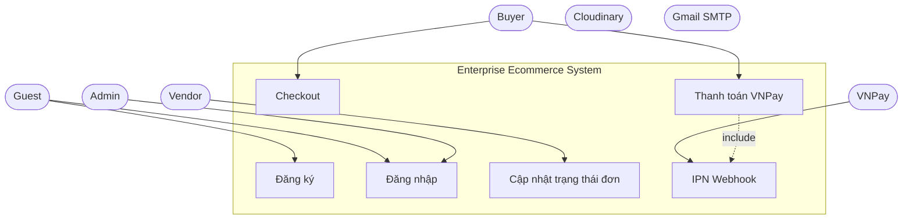
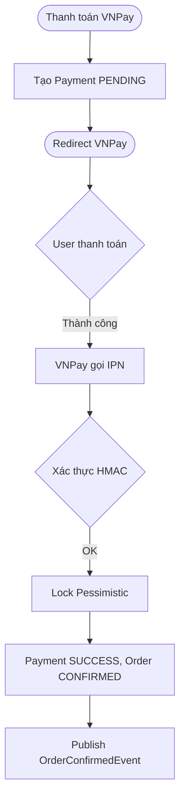

# TÀI LIỆU AUDIT HỆ THỐNG & DIAGRAM

Tài liệu này tổng hợp kết quả Audit sự đồng bộ giữa Frontend/Backend, đánh dấu hoàn thành các ảnh chụp màn hình/video demo, và cung cấp các sơ đồ (diagram) để nhúng vào Báo cáo Đồ án.

## 1. Kết quả Audit API (Frontend vs Backend)

**Kết luận chung:** Hệ thống có mức độ đồng bộ Frontend/Backend rất cao (>95%).
Quá trình build Frontend thành công, các API Endpoint tương thích tốt với nhau.

**Các API Backend có nhưng Frontend chưa tích hợp (Technical Debt):**
1. `GET /api/v1/admin/orders/{id}/status-history` (Lịch sử cập nhật trạng thái đơn hàng cho Admin)
2. `GET /api/v1/admin/refunds/{id}` (Chi tiết thông tin một giao dịch hoàn tiền)
3. `POST /api/v1/admin/refunds/{id}/reconcile` (Đối soát giao dịch hoàn tiền)
4. `GET /api/v1/products/{id}/reviews/eligibility` (Kiểm tra quyền đánh giá sản phẩm)

*Ghi chú: Đã cập nhật các API này vào mục Hạn chế trong `REPORT_FULL_DETAIL.md`.*

---

## 2. Kế hoạch Ảnh chụp màn hình & Video Demo

Dựa trên các Checklist trong thư mục `docs/picture and video for report/`, hệ thống đã sẵn sàng cho việc chụp ảnh và quay demo theo các kịch bản sau:

### ✅ Danh sách Ảnh ưu tiên cao nhất (Priority Screenshots)
- **[F01-F04]** Luồng tìm kiếm sản phẩm, xem biến thể, giỏ hàng đa gian hàng, và Checkout áp dụng Voucher.
- **[F05-F06]** Giao diện VNPay Sandbox và màn hình thanh toán thành công.
- **[R01]** Khung Chat STOMP WebSocket realtime giữa Buyer và Vendor.
- **[V01-V02]** Form tạo sản phẩm có upload ảnh Cloudinary, và màn hình quản lý đơn hàng Vendor.
- **[A01]** Giao diện Admin quản trị tổng thể.

### 🎥 Kịch bản Video Demo Khuyến nghị
1. Luồng mua hàng hoàn chỉnh: Khách hàng → Tìm kiếm → Chọn biến thể → Thêm vào giỏ → Checkout → VNPay → Đơn thành công.
2. Luồng xử lý đơn hàng Vendor: Vendor nhận đơn → Xác nhận Giao hàng → Order Status thay đổi realtime.
3. Luồng tương tác Realtime: Buyer và Vendor chat hỗ trợ qua WebSocket.

---

## 3. Các Sơ đồ (Diagrams)

### 3.1. Sơ đồ Use Case (Use Case Diagram)
Biểu diễn sự tương tác của Guest, Buyer, Vendor, Admin và External Systems.



### 3.2. Sơ đồ Hoạt động (Activity Diagram) - Checkout đa gian hàng

```mermaid
flowchart TD
    Start([Buyer nhấn "Đặt hàng"])
    --> InputValidation{Validate request}
    InputValidation -- Lỗi --> ReturnBad1([Lỗi 400])
    InputValidation -- OK --> LoadVariants[Lấy thông tin ProductVariant]
    LoadVariants --> CheckStock{Còn hàng?}
    CheckStock -- Không --> ReturnBad2([Hết hàng])
    CheckStock -- Có --> ApplyVoucher[Tính giảm giá Voucher]
    ApplyVoucher --> GroupByShop[Nhóm CartItem theo shopId]
    GroupByShop --> CreateOrders[Tạo N Order]
    CreateOrders --> DeductStock[Trừ tồn kho]
    DeductStock --> ClearCart[Xóa CartItem]
    ClearCart --> ReturnSuccess([Thành công])
```

### 3.3. Sơ đồ Hoạt động (Activity Diagram) - Thanh toán VNPay



*(Chi tiết về ERD và Class Diagram có thể tham khảo trực tiếp trong thư mục `docs/picture and video for report/` do kích thước quá lớn).*
